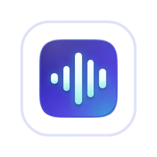
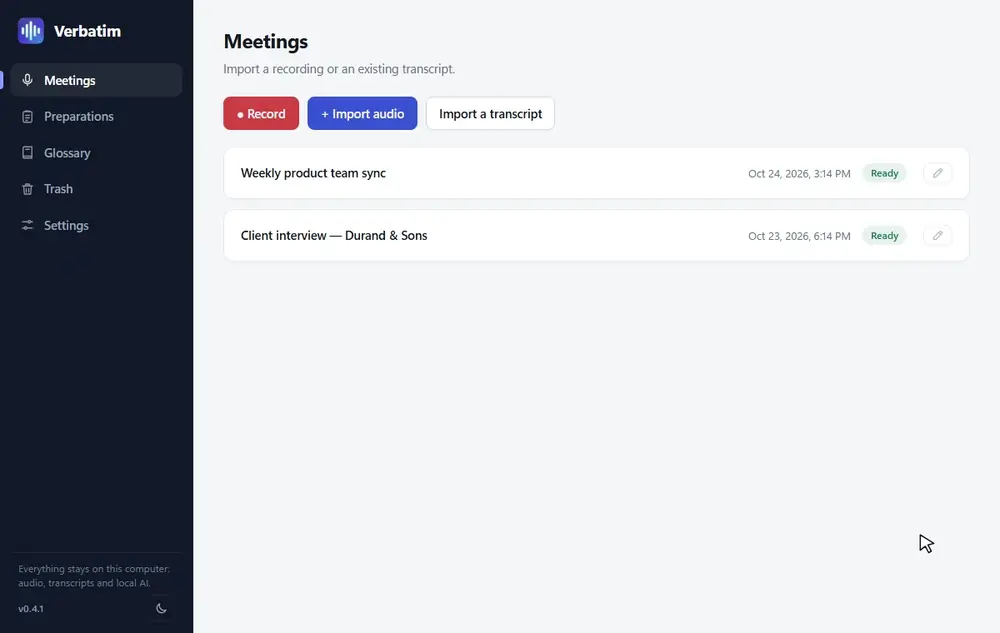
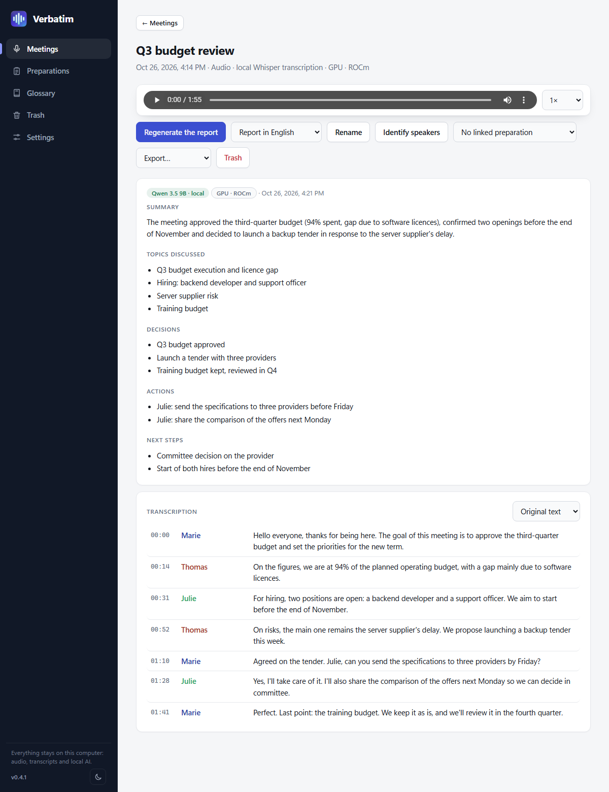

# Verbatim

### Your meetings, transcribed and summarized. On your own PC.

Verbatim records or imports your meetings, transcribes them with **Whisper**, tells who is speaking, then writes the report with a local AI (**Qwen**, Gemma or Ministral) that runs on your own computer. 
No account, no subscription, no telemetry: **nothing leaves your machine.**

     
     

**[Download](https://github.com/Netapick/verbatim/releases/latest)** &nbsp;·&nbsp; [Installation](#installation) &nbsp;·&nbsp; [FAQ](#faq) &nbsp;·&nbsp; [Features](#features) &nbsp;·&nbsp; [Performance](#performance) &nbsp;·&nbsp; [Roadmap](#roadmap) &nbsp;·&nbsp; [What's new](CHANGELOG.md)

[Français](README.md) · English

 

 Click the video to watch it with sound (40 s, in French)

 

 

## Why Verbatim?

| Strength | In practice |
|---|---|
| **100% local** | Audio, transcripts, reports and models stay on your computer. No cloud, no account, no data sent anywhere. |
| **Fast thanks to your graphics card** | NVIDIA (CUDA, Vulkan) or AMD (ROCm, Vulkan), with automatic fallback to the processor. A 15-minute recording is transcribed in **22 s** on an RX 7800 XT, versus 4 min 38 s on the processor. |
| **Who said what** | Every passage is attributed to a speaker, with one color per person. People who introduce themselves ("Hello, I'm Marie") are named throughout the meeting. |
| **From sound to report** | Summary, topics, decisions, actions and next steps from a simple recording: from 15 minutes of audio to the report in 1 min 10 s on a recent AMD card. |
| **Built for meetings** | Live transcription, preparations (agenda, questions), a glossary of business acronyms, translation, an audio player synced with the transcript. |

## How it works

1. **Record** a meeting (microphone, PC sound or both) or **import** an audio file or an existing transcript (drag and drop works).
2. **Transcribe**: Whisper turns speech into timestamped text, locally.
3. **Identify** the speakers: one color and one name per person, renamable in one click.
4. **Write**: a local AI produces the report, which you review, export or regenerate.

At startup, Verbatim preloads Whisper and speaker separation (a start screen shows the progress), so your first transcription does not wait. Everything is unloaded when the application closes.

## Features

| | |
|---|---|
| **Record or import** | Microphone, PC sound or both; background recording with a floating bar; audio or transcript import by drag and drop. |
| **Transcribe** | Local Whisper, live transcription, glossary of business terms. |
| **Identify the speakers** | One color and one name per person, fixable in one click or by multi-selection. |
| **Translate** | Transcript translated into 14 languages, live translation. |
| **Write the report** | Qwen, Gemma 4, Ministral 3 or your own GGUF models; language of your choice; pause and resume; length proportional to the duration. |
| **Look back** | Search across all meetings, synchronized audio player, exports, backup and restore, trash. |
| **Comfort** | Meeting preparations, themes, interface in 5 languages, estimated time remaining, safeguards on close. |

Every function in detail, with screenshots: **[Features](docs/FONCTIONNALITES.en.md)**.

## Supported hardware

| Graphics card | Transcription (Whisper) | Writing (Qwen) |
|---|---|---|
| **NVIDIA** | CUDA, otherwise Vulkan | CUDA, otherwise Vulkan |
| **AMD Radeon RX 7000 / PRO W7000** (RDNA 3) | ROCm | ROCm, otherwise Vulkan |
| Other AMD, Intel | Vulkan | Vulkan |
| No graphics card | Processor | Processor |

**Automatic** mode picks the fastest engine available and falls back to the processor if there is a problem. Models too large for your card's video memory are flagged in Settings.

whisper.cpp has no official binary for AMD cards on Windows: Verbatim ships its own builds (ROCm and Vulkan), described in [Hardware and performance](docs/MATERIEL-ET-PERFORMANCES.en.md).

## Performance

Measurements of 25 October 2026 on a desktop PC (Ryzen 7 5800X3D, 48 GB RAM, Radeon RX 7800 XT 16 GB), with a real 15 min 16 s recording in French and a real 1-hour meeting.

| | Result |
|---|---|
| **Transcription** | 15 min 16 s transcribed in **22 s** on ROCm (×41 real time), 36 s on Vulkan, 4 min 38 s on the processor: **12× faster** with a graphics card |
| **Live** | A 10 s excerpt is transcribed in **0.4 s** (ROCm) or 0.7 s (Vulkan): the text keeps up with the voice. On the processor, 13 s: too slow for live |
| **Since 0.3** | Transcription **1.5× faster** on ROCm (2.9× for a 1-hour meeting), **9.7× faster** on AMD cards older than the RX 7000 and on Intel, which move from the processor to Vulkan |
| **Speakers** | 38 s for 15 min, 2 min 30 s for 1 h, on the processor (×24 real time) |
| **Report** | 15 min: **9 s** (4B, ROCm), 26 s (Vulkan), 2 min 29 s (processor). 1-hour meeting: 20 s (4B, ROCm). The 27B: 42 s on ROCm, 17 min on the processor |
| **Video memory** | 1.5 GB for Whisper, 3.4 GB for the 4B, 5.7 GB for the 9B (an 8 GB card is enough for the whole chain), 11 GB for the 27B |
| **Processor** | 2 to 8% of the PC with a graphics card, versus 50% without |

Charts, full tables, comparison with previous versions and configuration advice: **[Hardware and performance](docs/MATERIEL-ET-PERFORMANCES.en.md)**.

## Installation

1. **Download** `Verbatim_X.Y.Z_x64-setup.exe` from the [latest release](https://github.com/Netapick/verbatim/releases/latest). The installer is light (about 9 MB) and offers French or English.
2. **Run it.** It downloads the engines by itself: the base pack (≈ 61 MB), then the acceleration suited to your card (ROCm ≈ 430 MB, Vulkan ≈ 17 MB, or CUDA ≈ 1.3 GB). It asks no questions and needs no administrator rights.
3. **Choose your models** in **Settings**: a transcription model, a writing model and, if you wish, a translation model. No model ships with the application; each is downloaded only once, and a download can be stopped (the partial file is then deleted). On first launch, a message takes you there.

Engines and models are stored in an `ia` folder next to the application. If you already have models (Ollama, `.gguf` or `ggml-*.bin` files), **Settings › Models** detects them and **copies** them into `ia`, without touching the originals.

### Automatic updates

At startup, Verbatim looks for the latest version published on GitHub. A **banner** at the top announces it, with its notes. Clicking **Update** opens a window in the center showing the download and then the installation, and the application restarts by itself. The update's signature (minisign) is verified before installation.

With **Install automatically** (Settings › General), the version is downloaded in the background, but **nothing is installed without your click** on "Update". The button stays greyed out, with the reason shown, during a recording, a transcription, a report, a translation or a download.

### If your antivirus blocks an engine

The third-party engines (whisper.cpp, llama.cpp) are not signed: some antivirus programs, including Windows Defender, may delete or block them ("access denied" or "connection closed" error).

1. Open *Windows Security › Virus & threat protection › Manage settings › Exclusions*.
2. Add Verbatim's installation folder (the one containing `ia`) as an exclusion.
3. Restore the files from *Protection history*, or restart the download from Settings.

Running the application as administrator does not help.

## Privacy

| What stays on your computer | What leaves, and only if you ask |
|---|---|
| Audio, transcripts, reports, preparations, glossary, models | Downloading engines and models (GitHub, Hugging Face) |
| All transcription, speaker separation and writing | Update check against the GitHub API (can be turned off) |
| Speakers' voices (computed on the fly, not stored) | A remote writing API, only if you configure one yourself |

No personal data is collected, and there is no telemetry. Full text: [privacy policy](docs/PRIVACY.en.md).

## FAQ

**Do I need an Internet connection?**
Only to download engines and models, and to check for updates. Transcription and writing work offline.

**Do I need a graphics card?**
No. Verbatim runs on the processor, but an NVIDIA or AMD card speeds up transcription and writing a lot (see [performance](#performance)).

**How much disk space and memory do I need?**
The base pack weighs about 61 MB. Each transcription model is 75 MB to 1.1 GB, each writing model about 2.1 to 19 GB, and each translation model (TranslateGemma) 2.5 to 7.3 GB. Qwen 3.5 4B needs about 4 GB of memory, the 9B about 8 GB.

**What language are the reports in?**
Your choice: the meeting's language (default) or another, settable per meeting. Verbatim's interface is available in French, English, Spanish, German and Italian, chosen in Settings (the installer is in French and English).

**Does translation send my text online?**
No: it uses a local model, like the report. The only exception: if you configured a remote API yourself and no local model is installed, that API is used.

**Does Verbatim tell speakers apart?**
Yes: each passage is attributed to a speaker, with one color per person, with nothing sent online. Click a name to rename it. The result stays approximate when voices are alike. Details: [Features](docs/FONCTIONNALITES.en.md#identify-the-speakers).

**Why is my report short?**
Its length follows the duration of the meeting: a 5 to 8 sentence summary for a meeting of 10 min or less, then more for long meetings, with lists of topics, decisions and actions. Decisions and actions are only listed when they are stated explicitly; the full transcript is always available alongside.

**Why does Windows or my antivirus show a warning?**
The installer and the engines have no Windows code signature. See the section on [antivirus](#if-your-antivirus-blocks-an-engine) and [signing](#signing).

## Roadmap

These are working leads, with no commitment on dates or order. What is already done is listed in the [milestones](docs/FONCTIONNALITES.en.md#milestones-reached) and in the [changelog](CHANGELOG.md).

**Under consideration**
- **Android port**: recording and viewing on a phone, depending on the feasibility of running Whisper and a small writing model locally.
- **Asking questions to a meeting**, with a link to the passage concerned.
- **Transcript correction** in the application.
- **Customizable report templates** (structure and tone).
- **Video import** and batch processing.
- **More convenient recording**: global shortcut, start offered when a video call opens.
- A **command-line mode**, **macOS and Linux**.

An idea or a need? Open an [issue](https://github.com/Netapick/verbatim/issues).

## Documentation

- [Features](docs/FONCTIONNALITES.en.md): every function in detail · [Hardware and performance](docs/MATERIEL-ET-PERFORMANCES.en.md): supported cards, measurements.
- [Illustrated tour](docs/PRESENTATION.en.md): a walk through the application, with screenshots.
- [Technical documentation](docs/DEVELOPMENT.en.md): architecture, build, distribution, updates.
- [Installation codes and error messages](docs/CODES.en.md): what each code or message means, and what to do.
- [Changelog](CHANGELOG.md): what is new in each version.
- [Contributing](CONTRIBUTING.md): report a bug, suggest an idea or code · [Security](SECURITY.md#security-policy): report a vulnerability.
- [Code signing](docs/SIGNATURE.en.md) · [Privacy policy](docs/PRIVACY.en.md) · [Antivirus false positives](docs/FAUX-POSITIFS.en.md)

## License

Code under the [MIT license](LICENSE). Third-party components (whisper.cpp, llama.cpp, ROCm) remain under their own licenses, detailed in each release's `THIRD-PARTY-LICENSES.md`.

### Signing

- The installer has no Windows code signature (certificate): Windows may show a warning at installation.
- The application's **updates** are signed by a minisign key specific to the project and built by GitHub Actions (`.github/workflows/release.yml`); the public key is in `src-tauri/tauri.conf.json`. The application refuses an update whose signature is invalid.
- The third-party engines (whisper.cpp, llama.cpp) are downloaded as published by their authors and are not signed by this project.
