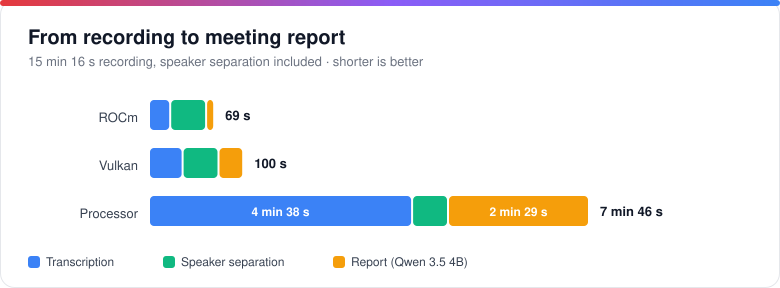
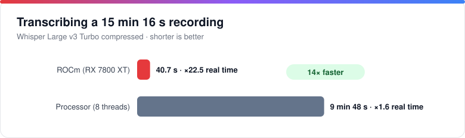
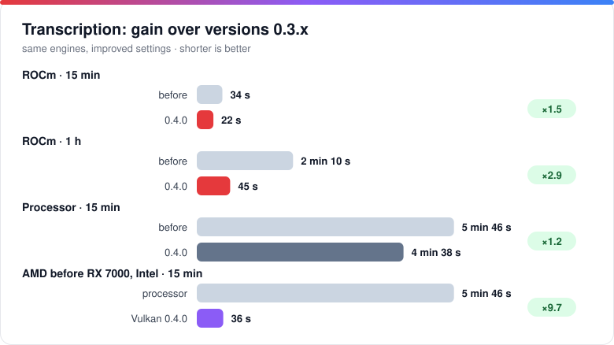
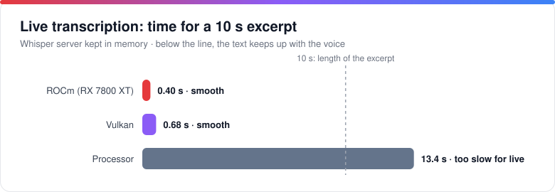
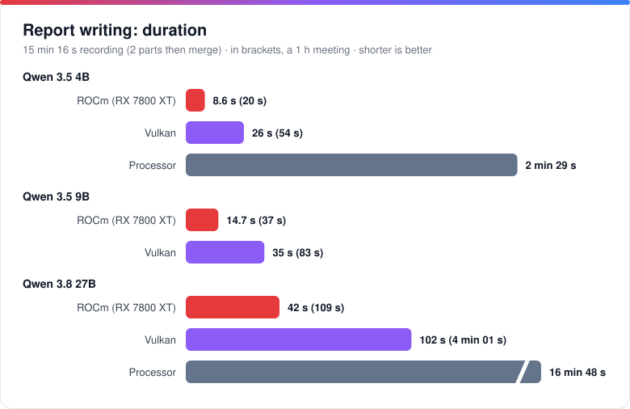
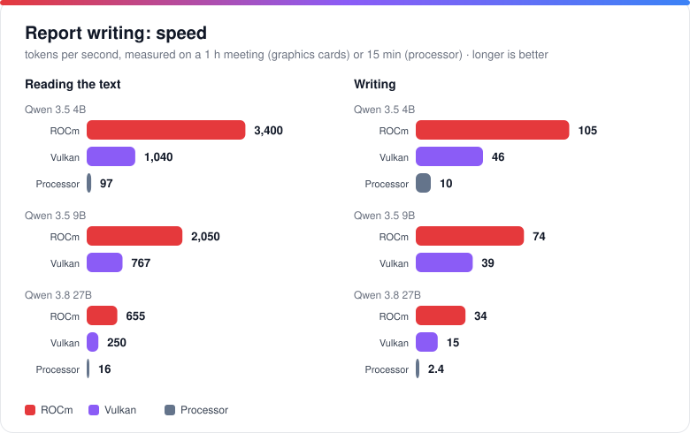
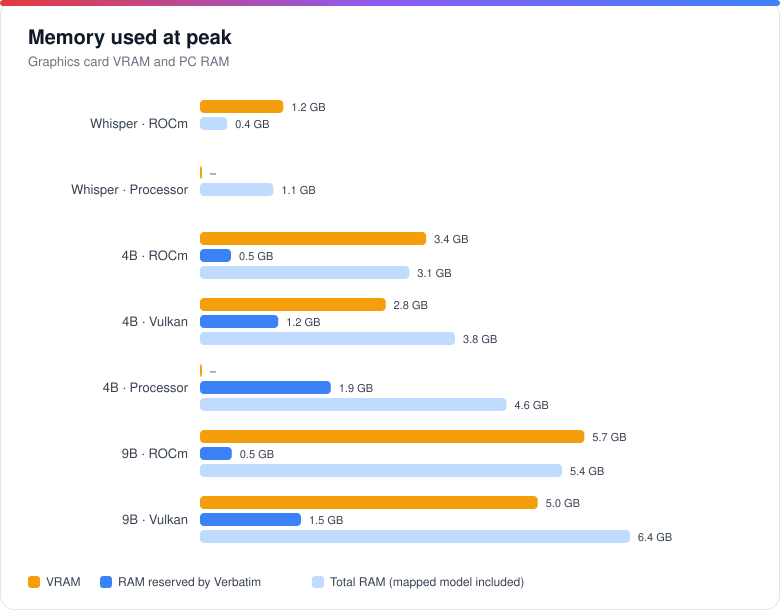
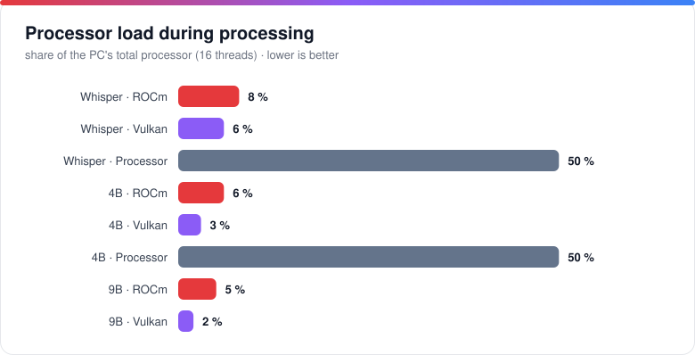

# Verbatim

### Your meetings, transcribed and summarized. On your own PC.

Verbatim records or imports your meetings, transcribes them with **Whisper**, tells who is speaking, then writes the report with a **Qwen** AI that runs on your own computer. 
No account, no subscription, no telemetry: **nothing leaves your machine.**

     

**[Download](https://github.com/Netapick/verbatim/releases/latest)** &nbsp;·&nbsp; [Features](#features) &nbsp;·&nbsp; [Performance](#performance) &nbsp;·&nbsp; [Installation](#installation) &nbsp;·&nbsp; [FAQ](#faq) &nbsp;·&nbsp; [Roadmap](#roadmap)

[Français](README.md) · English

 

*The screenshots show the French interface; the application is also available in English.*

 

## Why Verbatim?

| Strength | In practice |
|---|---|
| **100% local** | Audio, transcripts, reports and models stay on your computer. No cloud, no account, no data sent anywhere. |
| **Fast thanks to your graphics card** | NVIDIA (CUDA) or AMD (ROCm, Vulkan), with automatic fallback to the processor. A 15-minute recording is transcribed in **22 s** on an RX 7800 XT, versus 4 min 38 s on the processor. |
| **Who said what** | Every passage is attributed to a speaker, with one color per person. People who introduce themselves ("Hello, I'm Marie") are named throughout the meeting. |
| **From sound to report** | Summary, topics, decisions, actions and next steps from a simple recording: from 15 minutes of audio to the report in 1 min 10 s on a recent AMD card. |
| **Built for meetings** | Live transcription, preparations (agenda, questions), a glossary of business acronyms, translation, an audio player synced with the transcript. |

## How it works

1. **Record** a meeting (microphone, PC sound or both) or **import** an audio file or an existing transcript (drag and drop works).
2. **Transcribe**: Whisper turns speech into timestamped text, locally.
3. **Identify** the speakers: one color and one name per person, renamable in one click.
4. **Write**: a local AI produces the report, which you review, export or regenerate.

At startup, Verbatim preloads Whisper and speaker separation (a start screen shows the progress), so your first transcription does not wait. Everything is unloaded when the application closes.

## Features

### Record or import

- Capture the **microphone**, the **PC sound** (video calls, videos, through WASAPI loopback) or both, mixed to mono. Live levels, pause and resume, sensitivity setting.
- Audio is written to disk as it is recorded: after a crash or a power cut, the recording is recovered at the next launch (about 2 seconds lost at most).
- Import **audio** (mp3, m4a/aac, ogg, flac, wav…) or an **existing transcript** (txt, srt, vtt, md), from the menu or by drag and drop.
- A message reminds you to **say hello** at the start of a recording: that is what lets Verbatim name the voices (can be turned off).

### Transcribe with Whisper

- Local Whisper (whisper.cpp), with speech detection to limit hallucinations on silences.
- French, English, Spanish, German, Italian, or automatic language detection.
- **Live transcription** (checkbox in the recording panel): the text appears during the meeting, a few seconds behind; when you stop, the full transcript is redone for maximum quality.
- From the lightest model (Tiny, 75 MB) to the most accurate (Large v3), with compressed versions.
- A glossary of acronyms and business terms is passed to the model to limit errors on proper nouns.

### Identify the speakers

- After transcription, each passage is attributed to a speaker ("Speaker 1", "Speaker 2"…), with one color per person. The number of people is found automatically.
- Click a name to rename it: the name changes everywhere (transcript, translation, report, exports). The "Identify speakers" button handles a meeting that is already transcribed.
- If each person introduces themselves when they first speak, Verbatim remembers their voice and names it for the whole meeting.
- The work runs on the processor, with nothing sent online, about **24× faster than the audio** (38 s for 15 min, 2 min 30 s for 1 h). Very similar voices or very short sentences stay approximate.

### Translate

- **Transcript translation** into 14 languages, by a local AI (Google's **TranslateGemma**, or the report model), with timestamps kept: the player and highlighting also work on the translation. Exports (.txt, .srt, .vtt, .json) follow the displayed language.
- **Live translation** under each sentence of the live transcript.
- Compute on your choice of graphics card or processor in Settings › Translation; the hardware and model used are displayed.

### Write the report

- Summary, topics, decisions, actions and next steps, produced by a local AI: **Qwen 3.5** (4B or 9B), **Qwen 3.8 27B**, or your own GGUF models. Ollama and an OpenAI-compatible API remain possible as options.
- Long meetings are split into parts, summarized, then merged. The glossary and the linked preparation are given to the model.
- The report is deliberately **concise**: a 5 to 8 sentence summary, about 120 to 250 words whether the meeting lasts 15 min or 1 h.
- Without a writing model, Verbatim produces a simplified summary built from real sentences of the transcript, inventing nothing.
- **Report language of your choice**, independent of the meeting's language (French, English, Spanish, German, Italian, Portuguese, Dutch), as a default or meeting by meeting.
- While the report is written, Whisper is released to leave memory to the AI; the writing model stays loaded while the application is open.

### Prepare and look back

- **Preparations**: objective, timed agenda and questions to ask, with customizable meeting types.
- **Synced audio player** (0.75× to 2×): a click on a passage of the transcript starts playback at that moment.
- **Rename** a meeting from the meeting itself or straight from the list.
- **Export** as text, subtitles (.srt, .vtt), data (.json), report (.md) and the original audio, in the original or the translated language.
- **Light (default), dark or automatic theme**, nine palettes including **Kawaii** and **Gamer**, interface in French and English (Settings › General).
- **Safeguards**: if you close the application during a recording, a transcription or a report, it warns you before interrupting it.

## Supported hardware

| Graphics card | Transcription (Whisper) | Writing (Qwen) |
|---|---|---|
| **NVIDIA** | CUDA | CUDA, otherwise Vulkan |
| **AMD Radeon RX 7000 / PRO W7000** (RDNA 3) | ROCm | ROCm, otherwise Vulkan |
| Other AMD, Intel | Vulkan | Vulkan |
| No graphics card | Processor | Processor |

**Automatic** mode picks the fastest engine available and falls back to the processor if there is a problem. Models too large for your card's video memory are flagged in Settings.

### Whisper on AMD cards: builds made for Verbatim

whisper.cpp does not ship a binary to use an AMD card on Windows: only processor and NVIDIA (CUDA) versions are published. Verbatim fills the gap with two in-house builds:

- **ROCm (HIP)** for Radeon RX 7000 / PRO W7000 (RDNA 3), the fastest: script `scripts/build-whisper-rocm.ps1`, shipped with a minimal ROCm runtime (no need for AMD's SDK).
- **Vulkan** for other AMD cards and Intel: script `scripts/build-whisper-vulkan.ps1`, a 17 MB pack, with no embedded runtime (your driver provides Vulkan).
- Each exists as `whisper-cli` (files) and `whisper-server` (**live transcription**).
- **The installer sets up the right pack by itself**, and "Automatic" mode picks it, with fallback to the processor if there is a problem.

Tested on an RX 7800 XT.

## Performance

Measurements of 25 October 2026 on a desktop PC (Ryzen 7 5800X3D, 8 cores / 16 threads, 48 GB RAM, Radeon RX 7800 XT 16 GB), with a **real 15 min 16 s recording in French** and a real **1-hour** meeting, with the application's settings (version 0.4.0: Whisper Large v3 Turbo compressed, Qwen 3.5 Q4_K_M). Raw data: [`docs/benchmarks/results.json`](docs/benchmarks/results.json).

### At a glance

| | Result |
|---|---|
| **Transcription** | 15 min 16 s transcribed in **22 s** on ROCm (×41 real time), 36 s on Vulkan, 4 min 38 s on the processor: **12× faster** with a graphics card |
| ⏱**Live** | A 10 s excerpt is transcribed in **0.4 s** (ROCm) or 0.7 s (Vulkan): the text keeps up with the voice. On the processor, 13 s: too slow for live |
| **Since 0.3** | Transcription **1.5× faster** on ROCm (2.9× for a 1-hour meeting), **9.7× faster** on AMD cards older than the RX 7000 and on Intel, which move from the processor to Vulkan |
| **Speakers** | 38 s for 15 min, 2 min 30 s for 1 h, on the processor (×24 real time) |
| **Report** | 15 min: **9 s** (4B, ROCm), 26 s (Vulkan), 2 min 29 s (processor). 1-hour meeting: 20 s (4B, ROCm). The 27B: 42 s on ROCm, 17 min on the processor |
| **Video memory** | 1.5 GB for Whisper, 3.4 GB for the 4B, 5.7 GB for the 9B (an 8 GB card is enough for the whole chain), 11 GB for the 27B |
| **Processor** | 2 to 8% of the PC with a graphics card, versus 50% without |

### From recording to report

Total for the 15 min 16 s recording: transcription + speaker separation + report (Qwen 3.5 4B), the sum of the steps measured one by one.

### Transcription

| Engine | Time | Speed | RAM (peak) | VRAM (peak) | Processor |
|---|---:|---:|---:|---:|---|
| **ROCm** (RX 7800 XT) | **22 s** | ×41 real time | 367 MB | 1.5 GB | ≈ 1.3 core (8% of the PC) |
| Vulkan | 36 s | ×26 real time | 699 MB | 1.0 GB | ≈ 1 core (6% of the PC) |
| Processor (8 threads) | 4 min 38 s | ×3.3 real time | 1.3 GB | – | ≈ 8 cores (50% of the PC) |

Proportionally, a one-hour meeting would be transcribed in about 1 min 30 s on ROCm, 2 min 20 s on Vulkan and 18 min on the processor (linear estimate).

### Gain over previous versions

The engines are the same as before (whisper.cpp 1.9.2, llama.cpp b11700): the gain comes from the settings and options of 0.4.0, measured on the same machine with the same model.

| Case (transcription) | Versions 0.3.x | 0.4.0 | Gain | What changed |
|---|---:|---:|---:|---|
| ROCm · 15 min | 34 s | **22 s** | ×1.5 | greedy decoding (`-bs 1`), almost identical text (2% word difference) |
| ROCm · 1 h | 2 min 10 s | **45 s** | ×2.9 | same, and audio split into 3 parts processed in parallel (4.4 GB of VRAM instead of 1.5 GB) |
| Processor · 15 min | 5 min 46 s | **4 min 38 s** | ×1.2 | greedy decoding |
| AMD before RX 7000, Intel · 15 min | 5 min 46 s (processor) | **36 s** (Vulkan) | ×9.7 | Whisper on Vulkan: these cards were not used before |
| AMD before RX 7000, Intel · 1 h | ≈ 23 min (processor, linear estimate) | **2 min 11 s** (Vulkan) | ×10 | same |

For the report, the model now stays loaded in memory while the application is open: it is no longer read from disk for every report, which saves **3 to 5 s** for the 4B and 9B, and **5 to 32 s** for the 27B (the largest, especially the first time). Whisper is also preloaded at startup, which removes the wait before a recording with live transcription.

### Live transcription

The Whisper server loads in 1 to 1.6 s (it is preloaded at startup) and stays in memory: 94 MB of RAM and 1.4 GB of VRAM on ROCm, 335 MB and 1.0 GB on Vulkan, 920 MB on the processor.

### Report writing

| Model · engine | 15 min | 1 h | Reading | Writing | RAM (peak)¹ | VRAM (peak) | Processor |
|---|---:|---:|---:|---:|---:|---:|---:|
| 4B · **ROCm** | **8.6 s** | 20 s | 3,400 tok/s | 105 tok/s | 3.8 GB | 3.4 GB | 6% of the PC |
| 4B · Vulkan | 26 s | 54 s | 1,040 tok/s | 46 tok/s | 4.6 GB | 2.8 GB | 3% of the PC |
| 4B · Processor | 2 min 29 s | – | 97 tok/s | 10 tok/s | 5.3 GB | – | 50% of the PC |
| 9B · **ROCm** | **15 s** | 37 s | 2,050 tok/s | 74 tok/s | 6.1 GB | 5.7 GB | 5% of the PC |
| 9B · Vulkan | 35 s | 83 s | 767 tok/s | 39 tok/s | 7.1 GB | 5.0 GB | 2% of the PC |
| 27B · **ROCm** | **42 s** | 1 min 49 s | 655 tok/s | 34 tok/s | 12.4 GB | 11.1 GB | 4% of the PC |
| 27B · Vulkan | 1 min 42 s | 4 min 1 s | 250 tok/s | 15 tok/s | 13.6 GB | 10.4 GB | 2% of the PC |
| 27B · Processor | 16 min 48 s | – | 16 tok/s | 2.4 tok/s | 13.8 GB | – | 50% of the PC |

The application is measured as it really runs: the 15 min recording is split into 2 parts summarized one by one (≈ 9,900 tokens read, 550 to 1,100 written), then merged; the 1-hour meeting is split into 6 parts (≈ 25,000 tokens read). The 27B model tested is the lightened version (IQ3, 10.9 GB). Times are those of the **first report after the model has loaded**: a second report is up to twice as fast (the engine is already "warm").

¹ RAM includes the model file, memory-mapped by Windows: that part can be reclaimed at any time.

### Memory and processor

### Key takeaways

**1. The graphics card changes how you use it.** On the processor, transcribing a recording uses 8 of 16 cores for nearly a third of its duration, and the whole path (transcription, speakers, report) takes 7 min 46 s for 15 min of audio. On ROCm it takes 1 min 9 s while using only a few percent of the processor: the PC stays usable.

**2. ROCm or Vulkan?** On a Radeon RX 7000, ROCm transcribes 1.6× faster than Vulkan and writes 2 to 3× faster. Vulkan uses a little less video memory (0.5 to 0.7 GB less) and remains the universal choice: it works on AMD, NVIDIA and Intel, and is still 6× faster than the processor for writing with the 4B.

**3. Qwen 3.5 4B or 9B?** On ROCm, the 9B costs about 6 s more than the 4B for 15 min, 17 s more for 1 h. It writes slightly more detail (more actions and next steps picked up in our tests). The 4B stays useful on cards with 4 to 6 GB of VRAM and with no graphics card. The **27B** (42 s on ROCm for 15 min, 1 min 49 s for 1 h) writes fuller reports (220 to 330 words against 120 to 250) and picks up decisions and next steps that the small models miss; it needs about 11 GB of VRAM, i.e. a 16 GB card, and is unusable on the processor (nearly 17 min).

**4. Sizing memory.** Whisper is released while the report is written: the VRAM you need is that of the larger of the two jobs, i.e. 5.7 GB for the 9B on ROCm. An 8 GB card is therefore enough for the whole chain, a 6 GB card works with the 4B (3.4 GB), and the 27B needs a 16 GB card (11.1 GB).

**5. With no graphics card.** The result is still usable: 4 min 38 s of transcription, 38 s of speaker separation and 2 min 29 s of report (4B) for 15 min of audio. However the processor is heavily used (50% of the PC) and live transcription is too slow: lighter transcription models (Small, Base) are preferable.

**6. Which configuration should you pick?**

| Your hardware | Transcription | Recommended writing |
|---|---|---|
| Radeon RX 7000, 16 GB | ROCm | Qwen 3.8 27B · ROCm (most detailed) or Qwen 3.5 9B · ROCm |
| Radeon RX 7000, 8 GB or more | ROCm | Qwen 3.5 9B · ROCm |
| Other AMD or Intel card, 6 GB or more | Vulkan | Qwen 3.5 9B · Vulkan |
| Card with 4 to 6 GB | depends on the card | Qwen 3.5 4B · Vulkan or ROCm |
| NVIDIA | CUDA | CUDA or Vulkan (not measured) |
| No graphics card | Processor | Qwen 3.5 4B · Processor |

**Limits of the measurement.** One machine and one recording (transcription: average of 2 runs, a single one for the processor; comparison with versions 0.3.x: same binaries, old settings replayed, one run for 1 h); whisper.cpp v1.9.2, llama.cpp b11700. NVIDIA (CUDA) results were not measured, as the test machine has no such card. Speaker separation was timed on a single-voice recording: its speed does not depend on the number of people, but the quality of the result is not evaluated here. Gaps vary with the machine, the length of the text and the audio content.

## Installation

1. **Download** `Verbatim_X.Y.Z_x64-setup.exe` from the [latest release](https://github.com/Netapick/verbatim/releases/latest). The installer is light (about 9 MB) and offers French or English.
2. **Run it.** It downloads the engines by itself: the base pack (≈ 61 MB), then the acceleration suited to your card (ROCm ≈ 430 MB, Vulkan ≈ 17 MB, or CUDA ≈ 1.3 GB). It asks no questions and needs no administrator rights.
3. **Choose your models** in **Settings**: a transcription model, a writing model and, if you wish, a translation model. No model ships with the application; each is downloaded only once, and a download can be stopped (the partial file is then deleted). On first launch, a message takes you there.

Engines and models are stored in an `ia` folder next to the application. If you already have models (Ollama, `.gguf` or `ggml-*.bin` files), **Settings › Models** detects them and **copies** them into `ia`, without touching the originals.

### Automatic updates

At startup, Verbatim looks for the latest version published on GitHub. A **banner** at the top announces it, with its notes. Clicking **Update** opens a window in the center showing the download and then the installation, and the application restarts by itself. The update's signature (minisign) is verified before installation.

With **Install automatically** (Settings › General), the version is downloaded in the background, but **nothing is installed without your click** on "Update". The button stays greyed out, with the reason shown, during a recording, a transcription, a report, a translation or a download.

### If your antivirus blocks an engine

The third-party engines (whisper.cpp, llama.cpp) are not signed: some antivirus programs, including Windows Defender, may delete or block them ("access denied" or "connection closed" error).

1. Open *Windows Security › Virus & threat protection › Manage settings › Exclusions*.
2. Add Verbatim's installation folder (the one containing `ia`) as an exclusion.
3. Restore the files from *Protection history*, or restart the download from Settings.

Running the application as administrator does not help.

## Privacy

| What stays on your computer | What leaves, and only if you ask |
|---|---|
| Audio, transcripts, reports, preparations, glossary, models | Downloading engines and models (GitHub, Hugging Face) |
| All transcription, speaker separation and writing | Update check against the GitHub API (can be turned off) |
| Speakers' voices (computed on the fly, not stored) | A remote writing API, only if you configure one yourself |

No personal data is collected, and there is no telemetry. Full text: [privacy policy](docs/PRIVACY.en.md).

## FAQ

**Do I need an Internet connection?**
Only to download engines and models, and to check for updates. Transcription and writing work offline.

**Do I need a graphics card?**
No. Verbatim runs on the processor, but an NVIDIA or AMD card speeds up transcription and writing a lot (see [performance](#performance)).

**How much disk space and memory do I need?**
The base pack weighs about 61 MB. Each transcription model is 75 MB to 1.1 GB, each writing model about 2.7 to 16 GB, and each translation model (TranslateGemma) 2.5 to 7.3 GB. Qwen 3.5 4B needs about 4 GB of memory, the 9B about 8 GB.

**What language are the reports in?**
Your choice: the meeting's language (default) or another, settable per meeting. Verbatim's interface is available in French and English, chosen at installation or in Settings.

**Does translation send my text online?**
No: it uses a local model, like the report. The only exception: if you configured a remote API yourself and no local model is installed, that API is used.

**Does Verbatim tell speakers apart?**
Yes. After transcription, each passage is attributed to a speaker, with one color per person. The work runs on the processor, with nothing sent online, and the number of speakers is determined automatically. Click a name to rename it, or "Identify speakers" for a meeting already transcribed. If each person introduces themselves when they first speak ("Hello, I'm Marie"), Verbatim remembers their voice and names it throughout the meeting. The result stays approximate when voices are alike or sentences are very short.

**Why is my report short?**
It is designed to be concise: a 5 to 8 sentence summary and lists of topics, decisions and actions, about 120 to 250 words whatever the length of the meeting. Decisions and actions are only listed when they are stated explicitly; the full transcript is always available alongside.

**Why does Windows or my antivirus show a warning?**
The installer and the engines have no Windows code signature. See the section on [antivirus](#if-your-antivirus-blocks-an-engine) and [signing](#signing).

## Roadmap

These are working leads, with no commitment on dates or order.

**Done**
- ✅ **Speaker separation** (diarization) and recognition of people who introduce themselves.
- ✅ **GPU engines**: AMD (ROCm, Vulkan) and NVIDIA (CUDA), including Whisper on Vulkan for AMD cards older than the RX 7000 series and Intel.
- ✅ **Built-in update**: banner, download and installation inside the application, automatic restart, verified signature.
- ✅ **Fast startup**: Whisper and speaker separation preloaded, a start screen, safeguards on close.
- ✅ **English interface** (French by default, chosen in Settings › General).
- ✅ **Drag and drop** of audio files or transcripts.
- ✅ **Report language** of your choice, **transcript translation** into 14 languages, **live transcription** with translation.
- ✅ **Themes and palettes** (including Kawaii and Gamer).

**Priorities**
- **Backup and restore** of meetings, and a **wider model catalog** (Llama, Mistral, Gemma).
- **More detailed reports** for long meetings (a summary proportional to the duration).
- **More interface languages** (Spanish, German, Italian).
- **Code signing** of the installer, to remove Windows warnings (the request to SignPath was refused; another solution is to be chosen).

**Under consideration**
- **Android port**: recording and viewing on a phone, depending on the feasibility of running Whisper and a small writing model locally.
- **Asking questions to a meeting**, with a link to the passage concerned.
- **Search across all meetings** and **transcript correction** in the application.
- **Customizable report templates** (structure and tone).
- **Video import** and batch processing.
- **More convenient recording**: global shortcut, notification-area icon, start offered when a video call opens.
- **Audio enhancement** before transcription, a **command-line mode**, **macOS and Linux**.

An idea or a need? Open an [issue](https://github.com/Netapick/verbatim/issues).

## Documentation

- [Illustrated tour](docs/PRESENTATION.en.md): a walk through the application, with screenshots.
- [Technical documentation](docs/DEVELOPMENT.en.md): architecture, build, distribution, updates.
- [Changelog](CHANGELOG.md): what is new in each version.
- [Code signing](docs/SIGNATURE.en.md) · [Privacy policy](docs/PRIVACY.en.md)

## License

Code under the [MIT license](LICENSE). Third-party components (whisper.cpp, llama.cpp, ROCm) remain under their own licenses, detailed in each release's `THIRD-PARTY-LICENSES.md`.

### Signing

- The installer has no Windows code signature (certificate): Windows may show a warning at installation.
- The application's **updates** are signed by a minisign key specific to the project and built by GitHub Actions (`.github/workflows/release.yml`); the public key is in `src-tauri/tauri.conf.json`. The application refuses an update whose signature is invalid.
- The third-party engines (whisper.cpp, llama.cpp) are downloaded as published by their authors and are not signed by this project.
