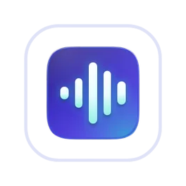
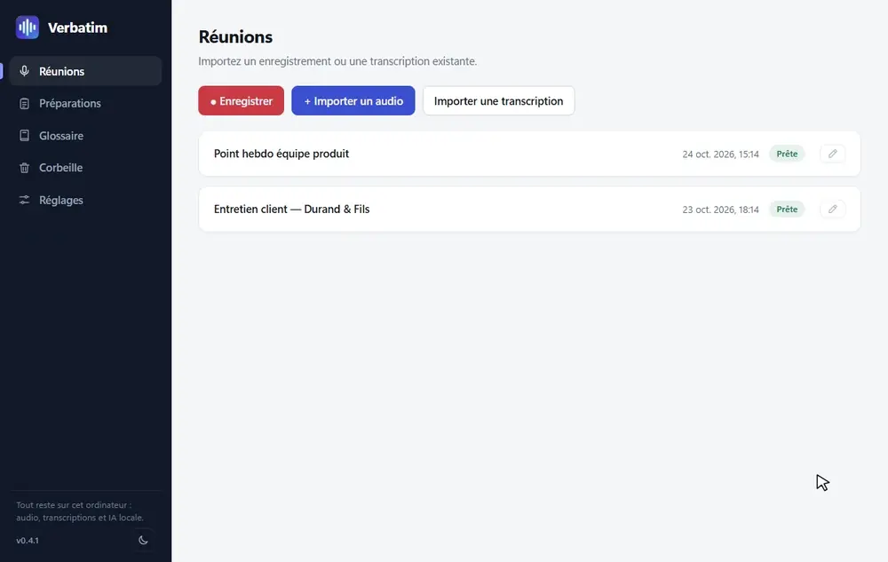
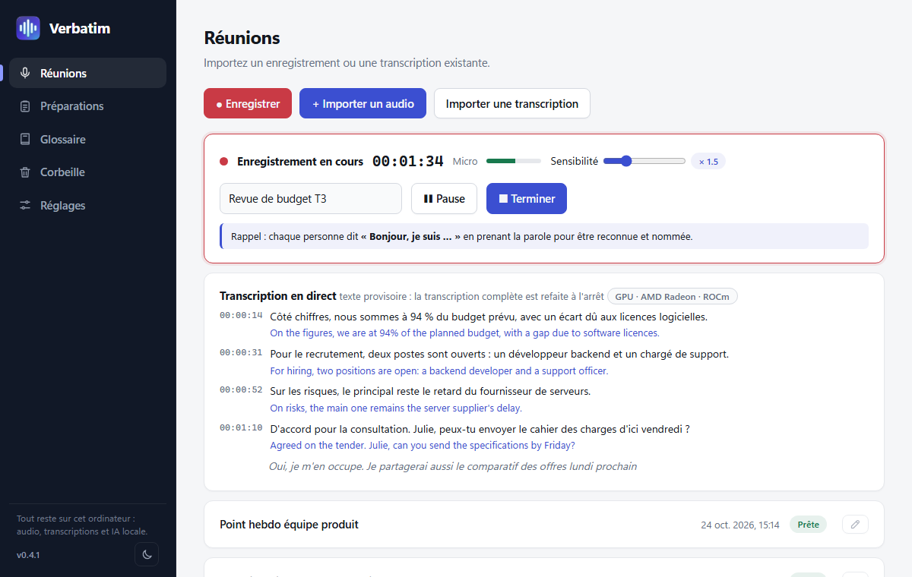
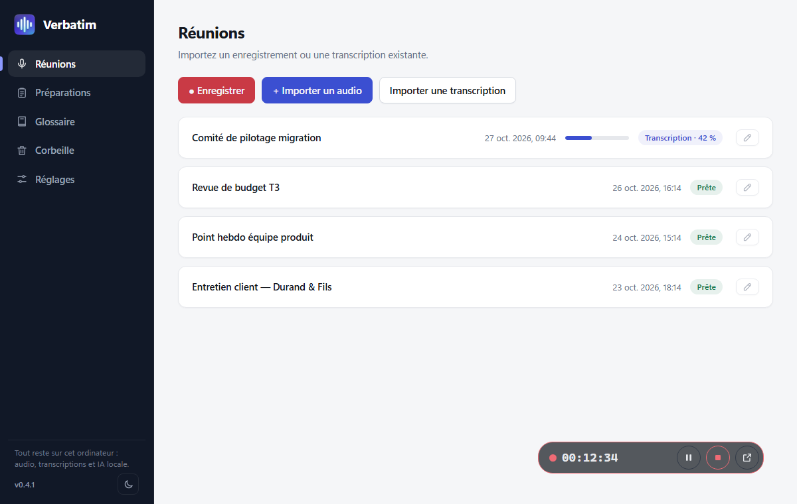
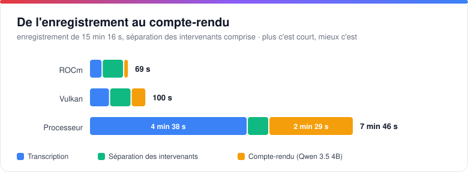
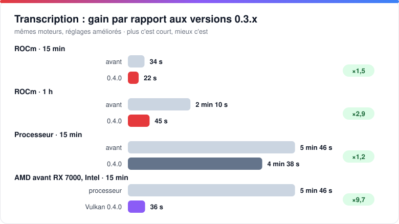
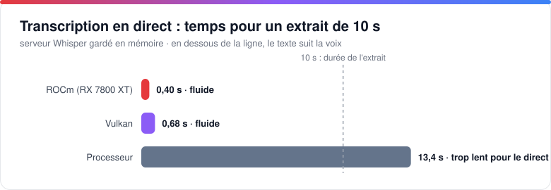

# Verbatim

### Vos réunions, transcrites et résumées. Chez vous, sur votre PC.

Verbatim enregistre ou importe vos réunions, les transcrit avec **Whisper**, identifie qui parle, puis rédige le compte-rendu avec une IA **Qwen** qui tourne sur votre propre ordinateur. 
Aucun compte, aucun abonnement, aucune télémétrie : **rien ne quitte votre machine.**

      

**[Télécharger](https://github.com/Netapick/verbatim/releases/latest)** &nbsp;·&nbsp; [Fonctionnalités](#fonctionnalités) &nbsp;·&nbsp; [Performances](#performances) &nbsp;·&nbsp; [Installation](#installation) &nbsp;·&nbsp; [FAQ](#faq) &nbsp;·&nbsp; [Feuille de route](#feuille-de-route)

Français · [English](README.en.md)

 

<a href="https://github.com/Netapick/verbatim/raw/main/docs/screenshots/demo.mp4">▶ Voir la vidéo (MP4, 53 s)</a>

 

## Pourquoi Verbatim ?

| Atout | En pratique |
|---|---|
| **100 % local** | L'audio, les transcriptions, les comptes-rendus et les modèles restent sur votre ordinateur. Pas de cloud, pas de compte, pas d'envoi de données. |
| **Rapide grâce à votre carte graphique** | NVIDIA (CUDA, Vulkan) ou AMD (ROCm, Vulkan), avec repli automatique sur le processeur. Un enregistrement de 15 min est transcrit en **22 s** sur une RX 7800 XT, contre 4 min 38 s sur processeur. |
| **Qui a dit quoi** | Chaque passage est attribué à un intervenant, avec une couleur par personne. Ceux qui se présentent (« Bonjour, je suis Marie ») sont nommés tout au long de la réunion. |
| **Du son au compte-rendu** | Résumé, points abordés, décisions, actions et suites, à partir d'un simple enregistrement : de l'audio de 15 min au compte-rendu en 1 min 10 s sur une carte AMD récente. |
| **Pensé pour les réunions** | Transcription en direct, préparations (ordre du jour, questions), glossaire de sigles métier, traduction, lecteur audio synchronisé. |

## Comment ça marche

1. **Enregistrez** une réunion (micro, son du PC ou les deux) ou **importez** un audio ou une transcription existante (un simple glisser-déposer suffit).
2. **Transcrivez** : Whisper convertit la parole en texte minuté, localement.
3. **Identifiez** les intervenants : une couleur et un nom par personne, renommables en un clic.
4. **Rédigez** : une IA locale produit le compte-rendu, que vous relisez, exportez ou régénérez.

Au démarrage, Verbatim charge d'avance Whisper et la séparation des intervenants (un écran de démarrage suit l'avancement) : la première transcription n'attend pas. Tout est déchargé à la fermeture de l'application.

## Fonctionnalités

### Enregistrer ou importer

- Capture du **microphone**, du **son du PC** (visio, vidéo, via la boucle WASAPI) ou des deux, mixés en mono. Niveaux en direct, pause et reprise, réglage de la sensibilité.
- L'audio est écrit sur le disque au fil de l'eau : après un plantage ou une coupure, l'enregistrement est reconstitué au prochain lancement (environ 2 secondes perdues au plus).
- **Enregistrement en arrière-plan** : au démarrage, la fenêtre se masque (plus de bouton dans la barre des tâches) et une **pastille flottante** translucide et déplaçable reste au premier plan, avec l'horloge, **pause / reprise**, **terminer** et le retour à la fenêtre. Une **icône dans la zone de notification** offre les mêmes actions (clic gauche : afficher).
- Import d'**audio** (mp3, m4a/aac, ogg, flac, wav…) ou d'une **transcription existante** (txt, srt, vtt, md), par le menu ou par glisser-déposer.
- Un message rappelle de **dire bonjour** en début d'enregistrement : c'est ce qui permet de nommer les voix (désactivable).

### Transcrire avec Whisper

- Whisper local (whisper.cpp), avec détection de parole pour limiter les hallucinations sur les silences.
- Français, anglais, espagnol, allemand, italien, ou détection automatique de la langue.
- **Transcription en direct** (case à cocher dans le panneau d'enregistrement, décochée par défaut) : le texte s'affiche pendant la réunion, avec quelques secondes de retard ; à l'arrêt, la transcription complète est refaite pour une qualité maximale.
- Du modèle le plus léger (Tiny, 75 Mo) au plus précis (Large v3), avec des versions compressées.
- Un glossaire de sigles et de termes métier est transmis au modèle pour limiter les erreurs sur les noms propres.

### Identifier les intervenants

- Après la transcription, chaque passage est attribué à un intervenant (« Intervenant 1 », « Intervenant 2 »…), avec une couleur par personne. Le nombre de personnes est trouvé automatiquement.
- Cliquez sur un nom pour le renommer : le nom change partout (transcription, traduction, compte-rendu, exports). Le bouton « Identifier les intervenants » traite une réunion déjà transcrite.
- Si chaque personne se présente en prenant la parole, Verbatim retient sa voix et la nomme pour toute la réunion.
- Le calcul se fait sur le processeur, sans rien envoyer en ligne, environ **24× plus vite que l'audio** (38 s pour 15 min, 2 min 30 s pour 1 h). Les voix très proches ou les phrases très courtes restent approximatives.

### Traduire

- **Traduction de la transcription** en 14 langues, par une IA locale (**TranslateGemma** de Google, ou le modèle du compte-rendu), avec les horodatages conservés : le lecteur et le surlignage fonctionnent aussi sur la traduction. Les exports (.txt, .srt, .vtt, .json) suivent la langue affichée.
- **Traduction en direct** sous chaque phrase de la transcription en direct.
- Calcul au choix (carte graphique ou processeur) dans Réglages › Traduction ; le matériel et le modèle utilisés sont affichés.

### Rédiger le compte-rendu

- Résumé, points abordés, décisions, actions et prochaines étapes, générés par une IA locale : **Qwen 3.5** (4B ou 9B), **Qwen 3.8 27B**, ou vos propres modèles GGUF. Ollama et une API compatible OpenAI restent possibles en option.
- Les réunions longues sont découpées en parties, résumées, puis fusionnées. Le glossaire et la préparation liée sont fournis au modèle.
- Le compte-rendu est volontairement **concis** : un résumé de 5 à 8 phrases, soit environ 120 à 250 mots que la réunion dure 15 min ou 1 h.
- Sans modèle de rédaction, Verbatim produit un résumé simplifié à partir de phrases réelles de la transcription, sans rien inventer.
- **Langue du compte-rendu au choix**, indépendante de celle de la réunion (français, anglais, espagnol, allemand, italien, portugais, néerlandais), par défaut ou réunion par réunion.
- Pendant la rédaction, Whisper est libéré pour laisser la mémoire à l'IA ; le modèle de rédaction reste chargé tant que l'application est ouverte.

### Préparer et retrouver

- **Préparations** : objectif, ordre du jour chronométré et questions à poser, avec des types de réunion personnalisables.
- **Lecteur audio synchronisé** (0,75× à 2×) : un clic sur un passage de la transcription lance la lecture à cet instant.
- **Renommer** une réunion depuis la réunion ou directement dans la liste.
- **Export** en texte, sous-titres (.srt, .vtt), données (.json), compte-rendu (.md) et audio d'origine, dans la langue d'origine ou traduite.
- **Thème clair (par défaut), sombre ou automatique**, neuf palettes dont **Kawaii** et **Gamer**, interface en français et en anglais (Réglages › Général).
- **Garde-fous** : si vous fermez l'application pendant un enregistrement, une transcription ou une rédaction, elle vous prévient avant de l'interrompre.

## Matériel pris en charge

| Carte graphique | Transcription (Whisper) | Rédaction (Qwen) |
|---|---|---|
| **NVIDIA** | CUDA, sinon Vulkan | CUDA, sinon Vulkan |
| **AMD Radeon RX 7000 / PRO W7000** (RDNA 3) | ROCm | ROCm, sinon Vulkan |
| Autres AMD, Intel | Vulkan | Vulkan |
| Sans carte graphique | Processeur | Processeur |

Le mode **Automatique** choisit le moteur le plus rapide disponible et revient sur le processeur en cas de problème. Les modèles trop volumineux pour la mémoire vidéo de votre carte sont signalés dans les Réglages.

### Whisper sur carte AMD : des builds faits pour Verbatim

whisper.cpp ne fournit pas de binaire pour utiliser une carte AMD sous Windows : seules les versions processeur et NVIDIA (CUDA) sont publiées. Verbatim comble ce manque avec deux builds maison :

- **ROCm (HIP)** pour les Radeon RX 7000 / PRO W7000 (RDNA 3), le plus rapide : script `scripts/build-whisper-rocm.ps1`, avec un runtime ROCm minimal livré avec lui (pas besoin du SDK d'AMD).
- **Vulkan** pour les autres AMD et les Intel : script `scripts/build-whisper-vulkan.ps1`, un pack de 17 Mo, sans runtime embarqué (le pilote fournit Vulkan).
- Chacun existe en `whisper-cli` (fichiers) et en `whisper-server` (**transcription en direct**).
- **L'installateur met en place le bon pack seul**, et le mode « Automatique » le choisit, avec repli sur le processeur en cas de problème.

Testé sur une RX 7800 XT.

## Performances

Mesures du 25 octobre 2026 sur un PC de bureau (Ryzen 7 5800X3D, 8 cœurs / 16 threads, 48 Go de RAM, Radeon RX 7800 XT 16 Go), avec un **enregistrement réel de 15 min 16 s en français** et une réunion réelle d'**1 heure**, aux réglages de l'application (version 0.4.0 : Whisper Large v3 Turbo compressé, Qwen 3.5 Q4_K_M). Données brutes : [`docs/benchmarks/results.json`](docs/benchmarks/results.json).

### En bref

| | Résultat |
|---|---|
| **Transcription** | 15 min 16 s transcrites en **22 s** sur ROCm (×41 le temps réel), 36 s sur Vulkan, 4 min 38 s sur processeur : **12× plus vite** avec une carte graphique |
| ⏱**Direct** | Un extrait de 10 s est transcrit en **0,4 s** (ROCm) ou 0,7 s (Vulkan) : le texte suit la voix. Sur processeur, 13 s : trop lent pour le direct |
| **Depuis la 0.3** | Transcription **1,5× plus rapide** sur ROCm (2,9× pour une réunion d'1 h), **9,7× plus rapide** sur les AMD d'avant la RX 7000 et les Intel, qui passent du processeur à Vulkan |
| **Intervenants** | 38 s pour 15 min, 2 min 30 s pour 1 h, sur le processeur (×24 le temps réel) |
| **Compte-rendu** | 15 min : **9 s** (4B, ROCm), 26 s (Vulkan), 2 min 29 s (processeur). Réunion d'1 h : 20 s (4B, ROCm). Le 27B : 42 s en ROCm, 17 min sur processeur |
| **Mémoire vidéo** | 1,5 Go pour Whisper, 3,4 Go pour le 4B, 5,7 Go pour le 9B (une carte de 8 Go suffit pour toute la chaîne), 11 Go pour le 27B |
| **Processeur** | 2 à 8 % du PC avec une carte graphique, contre 50 % sans |

### De l'enregistrement au compte-rendu

Total pour l'enregistrement de 15 min 16 s, transcription + séparation des intervenants + compte-rendu (Qwen 3.5 4B), somme des étapes mesurées une à une.

### Transcription

| Moteur | Durée | Vitesse | RAM (pic) | VRAM (pic) | Processeur |
|---|---:|---:|---:|---:|---|
| **ROCm** (RX 7800 XT) | **22 s** | ×41 temps réel | 367 Mo | 1,5 Go | ≈ 1,3 cœur (8 % du PC) |
| Vulkan | 36 s | ×26 temps réel | 699 Mo | 1,0 Go | ≈ 1 cœur (6 % du PC) |
| Processeur (8 threads) | 4 min 38 s | ×3,3 temps réel | 1,3 Go | – | ≈ 8 cœurs (50 % du PC) |

À proportion égale, une réunion d'une heure se transcrirait en environ 1 min 30 s sur ROCm, 2 min 20 s sur Vulkan et 18 min sur processeur (estimation linéaire).

### Gain par rapport aux versions précédentes

Les moteurs sont les mêmes qu'avant (whisper.cpp 1.9.2, llama.cpp b11700) : le gain vient des réglages et des options de la 0.4.0, mesurés sur la même machine avec le même modèle.

| Cas (transcription) | Versions 0.3.x | 0.4.0 | Gain | Ce qui change |
|---|---:|---:|---:|---|
| ROCm · 15 min | 34 s | **22 s** | ×1,5 | décodage glouton (`-bs 1`), texte quasi identique (écart de 2 % des mots) |
| ROCm · 1 h | 2 min 10 s | **45 s** | ×2,9 | idem, et audio découpé en 3 morceaux traités en parallèle (4,4 Go de VRAM au lieu de 1,5 Go) |
| Processeur · 15 min | 5 min 46 s | **4 min 38 s** | ×1,2 | décodage glouton |
| AMD avant RX 7000, Intel · 15 min | 5 min 46 s (processeur) | **36 s** (Vulkan) | ×9,7 | Whisper en Vulkan : ces cartes n'étaient pas utilisées avant |
| AMD avant RX 7000, Intel · 1 h | ≈ 23 min (processeur, estimation linéaire) | **2 min 11 s** (Vulkan) | ×10 | idem |

Côté compte-rendu, le modèle reste chargé en mémoire tant que l'application est ouverte : il n'est plus relu depuis le disque à chaque compte-rendu, ce qui économise **3 à 5 s** pour le 4B et le 9B, et **5 à 32 s** pour le 27B (le plus gros, surtout la première fois). Whisper est aussi préchargé au démarrage, ce qui supprime l'attente avant un enregistrement avec transcription en direct.

### Transcription en direct

Le serveur Whisper se charge en 1 à 1,6 s (il est préchargé au démarrage) et reste en mémoire : 94 Mo de RAM et 1,4 Go de VRAM sur ROCm, 335 Mo et 1,0 Go sur Vulkan, 920 Mo sur processeur.

### Rédaction du compte-rendu

| Modèle · moteur | 15 min | 1 h | Lecture | Écriture | RAM (pic)¹ | VRAM (pic) | Processeur |
|---|---:|---:|---:|---:|---:|---:|---:|
| 4B · **ROCm** | **8,6 s** | 20 s | 3 400 tok/s | 105 tok/s | 3,8 Go | 3,4 Go | 6 % du PC |
| 4B · Vulkan | 26 s | 54 s | 1 040 tok/s | 46 tok/s | 4,6 Go | 2,8 Go | 3 % du PC |
| 4B · Processeur | 2 min 29 s | – | 97 tok/s | 10 tok/s | 5,3 Go | – | 50 % du PC |
| 9B · **ROCm** | **15 s** | 37 s | 2 050 tok/s | 74 tok/s | 6,1 Go | 5,7 Go | 5 % du PC |
| 9B · Vulkan | 35 s | 83 s | 767 tok/s | 39 tok/s | 7,1 Go | 5,0 Go | 2 % du PC |
| 27B · **ROCm** | **42 s** | 1 min 49 s | 655 tok/s | 34 tok/s | 12,4 Go | 11,1 Go | 4 % du PC |
| 27B · Vulkan | 1 min 42 s | 4 min 1 s | 250 tok/s | 15 tok/s | 13,6 Go | 10,4 Go | 2 % du PC |
| 27B · Processeur | 16 min 48 s | – | 16 tok/s | 2,4 tok/s | 13,8 Go | – | 50 % du PC |

L'application procède comme dans l'usage réel : l'enregistrement de 15 min est découpé en 2 parties résumées une à une (≈ 9 900 tokens lus, 550 à 1 100 écrits), puis fusionnées ; la réunion d'1 h en 6 parties (≈ 25 000 tokens lus). Le modèle 27B testé est la version allégée (IQ3, 10,9 Go). Les durées sont celles de la **première rédaction après le chargement du modèle** : une deuxième rédaction est jusqu'à deux fois plus rapide (le moteur est déjà « chaud »).

¹ La RAM comprend le fichier du modèle, mappé en mémoire par Windows : cette part est récupérable à tout moment.

### Mémoire et processeur

### Ce qu'il faut retenir

**1. La carte graphique change l'usage.** Sur processeur, transcrire un enregistrement mobilise 8 cœurs sur 16 pendant près du tiers de sa durée, et tout le parcours (transcription, intervenants, compte-rendu) prend 7 min 46 s pour 15 min d'audio. Sur ROCm, il prend 1 min 9 s en n'occupant que quelques pour cent du processeur : le PC reste utilisable.

**2. ROCm ou Vulkan ?** Sur une Radeon RX 7000, ROCm transcrit 1,6× plus vite que Vulkan et rédige 2 à 3× plus vite. Vulkan consomme un peu moins de mémoire vidéo (0,5 à 0,7 Go de moins) et reste le choix universel : il fonctionne sur AMD, NVIDIA et Intel, et reste 6× plus rapide que le processeur pour la rédaction du 4B.

**3. Qwen 3.5 4B ou 9B ?** Sur ROCm, le 9B coûte environ 6 s de plus que le 4B pour 15 min, 17 s de plus pour 1 h. Il rédige un peu plus de détails (davantage d'actions et de suites repérées dans nos essais). Le 4B garde son intérêt sur les cartes de 4 à 6 Go de VRAM et sans carte graphique. Le **27B** (42 s sur ROCm pour 15 min, 1 min 49 s pour 1 h) écrit des comptes-rendus plus étoffés (220 à 330 mots contre 120 à 250) et repère des décisions et des suites que les petits modèles manquent ; il demande environ 11 Go de VRAM, soit une carte de 16 Go, et il est inutilisable sur processeur (près de 17 min).

**4. Dimensionnement de la mémoire.** Whisper est libéré pendant la rédaction : la VRAM nécessaire est celle du plus gros des deux traitements, soit 5,7 Go pour le 9B sur ROCm. Une carte de 8 Go suffit donc pour toute la chaîne, une carte de 6 Go convient avec le 4B (3,4 Go), et il faut une carte de 16 Go pour le 27B (11,1 Go).

**5. Sans carte graphique.** Le résultat reste exploitable : 4 min 38 s de transcription, 38 s de séparation des intervenants et 2 min 29 s de compte-rendu (4B) pour 15 min d'audio. En revanche le processeur est fortement sollicité (50 % du PC), et la transcription en direct est trop lente : des modèles de transcription plus légers (Small, Base) sont à privilégier.

**6. Quelle configuration choisir ?**

| Votre matériel | Transcription | Rédaction conseillée |
|---|---|---|
| Radeon RX 7000, 16 Go | ROCm | Qwen 3.8 27B · ROCm (le plus détaillé) ou Qwen 3.5 9B · ROCm |
| Radeon RX 7000, 8 Go ou plus | ROCm | Qwen 3.5 9B · ROCm |
| Autre carte AMD ou Intel, 6 Go ou plus | Vulkan | Qwen 3.5 9B · Vulkan |
| Carte de 4 à 6 Go | selon la carte | Qwen 3.5 4B · Vulkan ou ROCm |
| NVIDIA | CUDA | CUDA ou Vulkan (non mesuré) |
| Sans carte graphique | Processeur | Qwen 3.5 4B · Processeur |

**Limites de la mesure.** Une seule machine et un seul enregistrement (transcription : moyenne de 2 passes, 1 seule pour le processeur ; comparaison avec les versions 0.3.x : mêmes binaires, anciens réglages rejoués, une passe pour 1 h) ; whisper.cpp v1.9.2, llama.cpp b11700. Les résultats NVIDIA (CUDA) n'ont pas été mesurés, faute de carte sur la machine de test. La séparation des intervenants a été chronométrée sur un enregistrement à une seule voix : sa vitesse ne dépend pas du nombre de personnes, mais la qualité du résultat n'est pas évaluée ici. Les écarts varient selon la machine, la longueur du texte et le contenu audio.

## Installation

1. **Téléchargez** `Verbatim_X.Y.Z_x64-setup.exe` depuis la [dernière release](https://github.com/Netapick/verbatim/releases/latest). L'installateur est léger (environ 9 Mo) et propose le français ou l'anglais.
2. **Lancez-le.** Il télécharge seul les moteurs : le pack de base (≈ 61 Mo), puis l'accélération adaptée à votre carte (ROCm ≈ 430 Mo, Vulkan ≈ 17 Mo, ou CUDA ≈ 1,3 Go). Il ne pose aucune question et ne demande pas de droits administrateur.
3. **Choisissez vos modèles** dans **Réglages** : un modèle de transcription, un modèle de rédaction et, si vous le souhaitez, un modèle de traduction. Aucun modèle n'est livré avec l'application ; chacun n'est téléchargé qu'une seule fois, et un téléchargement peut être arrêté (le fichier partiel est alors supprimé). Au premier lancement, un message vous y conduit.

Les moteurs et les modèles sont rangés dans un dossier `ia` à côté de l'application. Si vous avez déjà des modèles (Ollama, fichiers `.gguf` ou `ggml-*.bin`), **Réglages › Modèles** les détecte et les **copie** dans `ia`, sans toucher aux originaux.

### Mises à jour automatiques

Au démarrage, Verbatim cherche la dernière version publiée sur GitHub. Un **bandeau** en haut l'annonce, avec ses notes. En cliquant sur **Mettre à jour**, une fenêtre au centre montre le téléchargement puis l'installation, et l'application redémarre toute seule. La signature de la mise à jour (minisign) est vérifiée avant l'installation.

Avec **Installer automatiquement** (Réglages › Général), la version est téléchargée en arrière-plan, mais **rien n'est installé sans votre clic** sur « Mettre à jour ». Le bouton reste grisé, avec la raison affichée, pendant un enregistrement, une transcription, une rédaction, une traduction ou un téléchargement.

### Si votre antivirus bloque un moteur

Les moteurs tiers (whisper.cpp, llama.cpp) ne sont pas signés : certains antivirus, dont Windows Defender, peuvent les supprimer ou les bloquer (erreur « accès refusé » ou « connexion fermée »).

1. Ouvrez *Sécurité Windows › Protection contre les virus et menaces › Gérer les paramètres › Exclusions*.
2. Ajoutez le dossier d'installation de Verbatim (celui qui contient `ia`) comme exclusion.
3. Restaurez les fichiers dans *Historique de protection*, ou relancez le téléchargement depuis les Réglages.

Lancer l'application en administrateur n'aide pas.

## Confidentialité

| Ce qui reste sur votre ordinateur | Ce qui sort, et seulement si vous le demandez |
|---|---|
| Audio, transcriptions, comptes-rendus, préparations, glossaire, modèles | Téléchargement des moteurs et des modèles (GitHub, Hugging Face) |
| Toute la transcription, la séparation des intervenants et la rédaction | Recherche de mise à jour auprès de l'API GitHub (désactivable) |
| Les voix des intervenants (calculées à la volée, non conservées) | Une API distante de rédaction, uniquement si vous la configurez vous-même |

Aucune donnée personnelle n'est collectée, et il n'y a aucune télémétrie. Texte complet : [politique de confidentialité](docs/PRIVACY.md).

## FAQ

**Faut-il une connexion Internet ?**
Seulement pour télécharger les moteurs et les modèles, et pour chercher les mises à jour. La transcription et la rédaction fonctionnent hors ligne.

**Faut-il une carte graphique ?**
Non. Verbatim fonctionne sur le processeur, mais une carte NVIDIA ou AMD accélère nettement la transcription et la rédaction (voir les [performances](#performances)).

**Quelle place et quelle mémoire faut-il ?**
Le pack de base pèse environ 61 Mo. Chaque modèle de transcription fait de 75 Mo à 1,1 Go, chaque modèle de rédaction de 2,7 à 16 Go environ, et chaque modèle de traduction (TranslateGemma) de 2,5 à 7,3 Go. Qwen 3.5 4B demande environ 4 Go de mémoire, le 9B environ 8 Go.

**Dans quelle langue sont les comptes-rendus ?**
Au choix : dans la langue de la réunion (par défaut) ou dans une autre, réglable par réunion. L'interface de Verbatim est disponible en français et en anglais, au choix à l'installation ou dans les Réglages.

**La traduction envoie-t-elle mon texte en ligne ?**
Non : elle utilise un modèle local, comme le compte-rendu. Seule exception : si vous avez configuré vous-même une API distante et qu'aucun modèle local n'est installé, c'est cette API qui est utilisée.

**Verbatim distingue-t-il les intervenants ?**
Oui. Après la transcription, chaque passage est attribué à un intervenant, avec une couleur par personne. Le calcul se fait sur le processeur, sans rien envoyer en ligne, et le nombre d'intervenants est déterminé automatiquement. Cliquez sur un nom pour le renommer, ou sur « Identifier les intervenants » pour une réunion déjà transcrite. Si chaque personne se présente en prenant la parole (« Bonjour, je suis Marie »), Verbatim retient sa voix et la nomme tout au long de la réunion. Le résultat reste approximatif quand des voix se ressemblent ou que les phrases sont très courtes.

**Pourquoi mon compte-rendu est-il court ?**
Il est conçu pour être concis : un résumé de 5 à 8 phrases et des listes de sujets, décisions et actions, soit 120 à 250 mots quelle que soit la durée de la réunion. Les décisions et les actions ne sont listées que si elles sont dites explicitement ; la transcription complète reste toujours disponible à côté.

**Pourquoi Windows ou mon antivirus affiche-t-il un avertissement ?**
L'installateur et les moteurs n'ont pas de signature de code Windows. Voir la section sur l'[antivirus](#si-votre-antivirus-bloque-un-moteur) et la [signature](#signature).

## Feuille de route

Ce sont des pistes de travail, sans engagement de date ni d'ordre.

**Réalisé**
- ✅ **Séparation des intervenants** (diarisation) et reconnaissance de ceux qui se présentent.
- ✅ **Moteurs GPU** : AMD (ROCm, Vulkan) et NVIDIA (CUDA, Vulkan), y compris Whisper en Vulkan pour les AMD d'avant la série RX 7000 et Intel.
- ✅ **Mise à jour intégrée** : bandeau, téléchargement et installation dans l'application, redémarrage automatique, signature vérifiée.
- ✅ **Démarrage rapide** : Whisper et la séparation préchargés, écran de démarrage, garde-fous à la fermeture.
- ✅ **Interface en anglais** (français par défaut, choix dans Réglages › Général).
- ✅ **Glisser-déposer** de fichiers audio ou de transcriptions.
- ✅ **Langue du compte-rendu** au choix, **traduction** de la transcription en 14 langues, **transcription en direct** avec traduction.
- ✅ **Thèmes et palettes** (dont Kawaii et Gamer).
- ✅ **Enregistrement en arrière-plan** : pastille flottante (pause, terminer) et icône dans la zone de notification.

**Priorités**
- **Sauvegarde et restauration** des réunions, et **catalogue de modèles élargi** (Llama, Mistral, Gemma).
- **Compte-rendu plus détaillé** pour les longues réunions (résumé proportionnel à la durée).
- **Plus de langues d'interface** (espagnol, allemand, italien).
- **Signature de code** de l'installateur, pour supprimer les avertissements de Windows (la demande à SignPath a été refusée ; une autre solution est à choisir).

**À l'étude**
- **Portage Android** : enregistrement et consultation sur téléphone, selon la faisabilité de l'exécution locale de Whisper et d'un petit modèle de rédaction.
- **Poser des questions à une réunion**, avec renvoi vers le passage concerné.
- **Recherche dans toutes les réunions** et **correction de la transcription** dans l'application.
- **Modèles de comptes-rendus personnalisables** (structure et ton).
- **Import de vidéos** et traitement par lots.
- **Enregistrement plus pratique** : raccourci global, démarrage proposé à l'ouverture d'une visioconférence.
- **Amélioration audio** avant transcription, **mode ligne de commande**, **macOS et Linux**.

Une idée ou un besoin ? Ouvrez une [issue](https://github.com/Netapick/verbatim/issues).

## Documentation

- [Présentation illustrée](docs/PRESENTATION.md) : le tour de l'application, avec captures d'écran.
- [Documentation technique](docs/DEVELOPMENT.md) : architecture, construction, distribution, mises à jour.
- [Codes d'installation et messages d'erreur](docs/CODES.md) : que signifie chaque code ou message, et que faire.
- [Historique des versions](CHANGELOG.md) : nouveautés de chaque version.
- [Signature du code](docs/SIGNATURE.md) · [Politique de confidentialité](docs/PRIVACY.md)

## Licence

Code sous licence [MIT](LICENSE). Les composants tiers (whisper.cpp, llama.cpp, ROCm) restent sous leurs licences respectives, détaillées dans `THIRD-PARTY-LICENSES.md` de chaque release.

### Signature

- L'installateur n'a pas de signature de code Windows (certificat) : Windows peut afficher un avertissement à l'installation.
- Les **mises à jour** de l'application sont signées par une clé minisign propre au projet, construites par GitHub Actions (`.github/workflows/release.yml`) ; la clé publique est dans `src-tauri/tauri.conf.json`. L'application refuse une mise à jour dont la signature est invalide.
- Les moteurs tiers (whisper.cpp, llama.cpp) sont téléchargés tels que publiés par leurs auteurs et ne sont pas signés par ce projet.
