

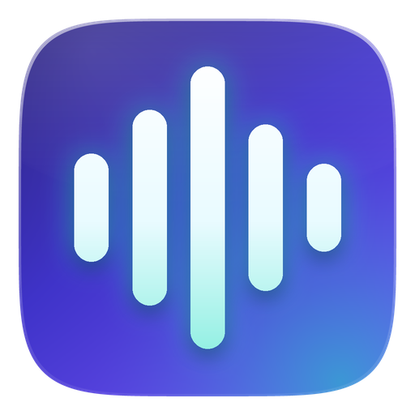

# Verbatim

### Vos réunions, transcrites et résumées. Chez vous, sur votre PC.

Verbatim enregistre ou importe vos réunions, les transcrit avec **Whisper**, puis rédige le compte-rendu avec une IA **Qwen** qui tourne sur votre propre ordinateur. 
Aucun compte, aucun abonnement, aucune télémétrie : **rien ne quitte votre machine.**

     

**[⬇ Télécharger](https://github.com/Netapick/verbatim/releases/latest)** &nbsp;·&nbsp; [Fonctionnalités](#fonctionnalités) &nbsp;·&nbsp; [Installation](#installation) &nbsp;·&nbsp; [FAQ](#faq) &nbsp;·&nbsp; [Feuille de route](#feuille-de-route) &nbsp;·&nbsp; [Documentation](#documentation)

Français · [English](README.en.md)

 

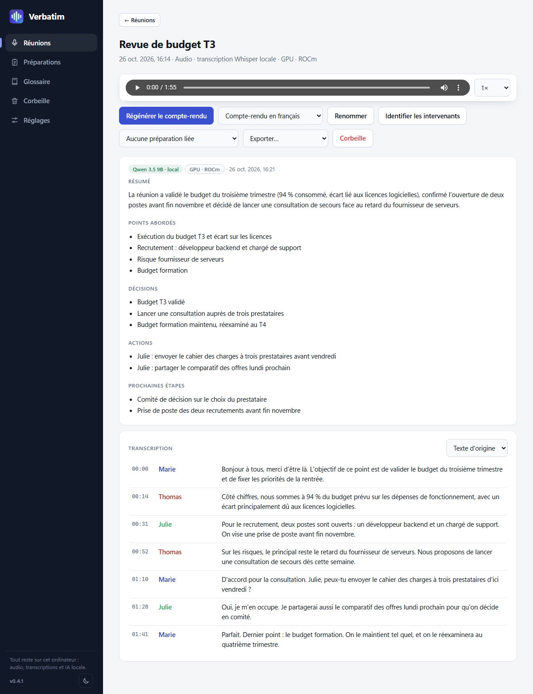

 

## Pourquoi Verbatim ?

| Atout | En pratique |
|---|---|
| 🔒 **100 % local** | L'audio, les transcriptions, les comptes-rendus et les modèles restent sur votre ordinateur. Pas de cloud, pas de compte, pas d'envoi de données. |
| ⚡ **Rapide grâce à votre carte graphique** | NVIDIA (CUDA) ou AMD (ROCm, Vulkan), avec repli automatique sur le processeur. Un enregistrement de 15 min est transcrit en 41 s sur une RX 7800 XT, contre près de 10 min sur processeur. |
| 📝 **Du son au compte-rendu** | Résumé, points abordés, décisions, actions et prochaines étapes, à partir d'un simple enregistrement. |
| 🧰 **Pensé pour les réunions** | Préparations (ordre du jour, questions), glossaire de sigles métier, lecteur audio synchronisé avec la transcription. |

## Comment ça marche

1. **Enregistrez** une réunion (micro, son du PC ou les deux) ou **importez** un audio ou une transcription existante.
2. **Transcrivez** : Whisper convertit la parole en texte minuté, localement.
3. **Rédigez** : une IA locale produit le compte-rendu, que vous relisez, exportez ou régénérez.

## Fonctionnalités

### Enregistrer ou importer

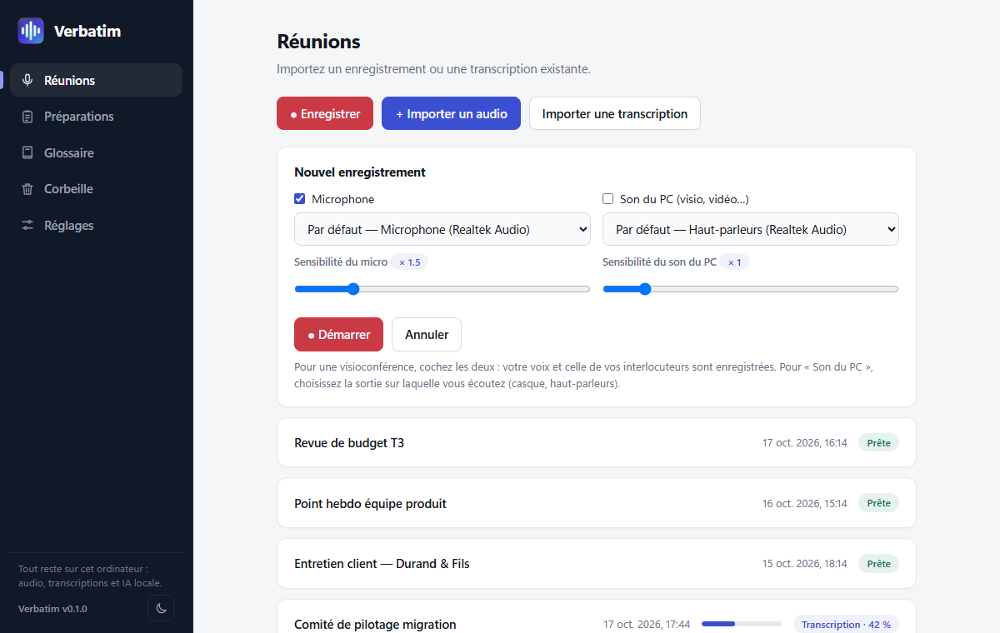

- Capture du **microphone**, du **son du PC** (visio, vidéo, via la boucle WASAPI) ou des deux, mixés en mono. Niveaux en direct, pause et reprise, réglage de la sensibilité.
- L'audio est écrit sur le disque au fil de l'eau : après un plantage ou une coupure, l'enregistrement est reconstitué au prochain lancement (environ 2 secondes perdues au plus).
- Import d'**audio** (mp3, m4a/aac, ogg, flac, wav…) ou d'une **transcription existante** (txt, srt, vtt, md).

### Transcrire avec Whisper

- Whisper local (whisper.cpp), avec détection de parole pour limiter les hallucinations sur les silences.
- Français, anglais, espagnol, allemand, italien, ou détection automatique de la langue.
- **Transcription en direct** (case à cocher dans le panneau d'enregistrement) : Whisper se charge à l'ouverture du panneau (le bouton « Démarrer » reste grisé le temps du chargement) ; le texte s'affiche pendant la réunion, avec quelques secondes de retard ; à l'arrêt, la transcription complète est refaite pour une qualité maximale.
- Du modèle le plus léger (Tiny, 75 Mo) au plus précis (Large v3), avec des versions compressées.
- Un glossaire de sigles et de termes métier est transmis au modèle pour limiter les erreurs sur les noms propres.

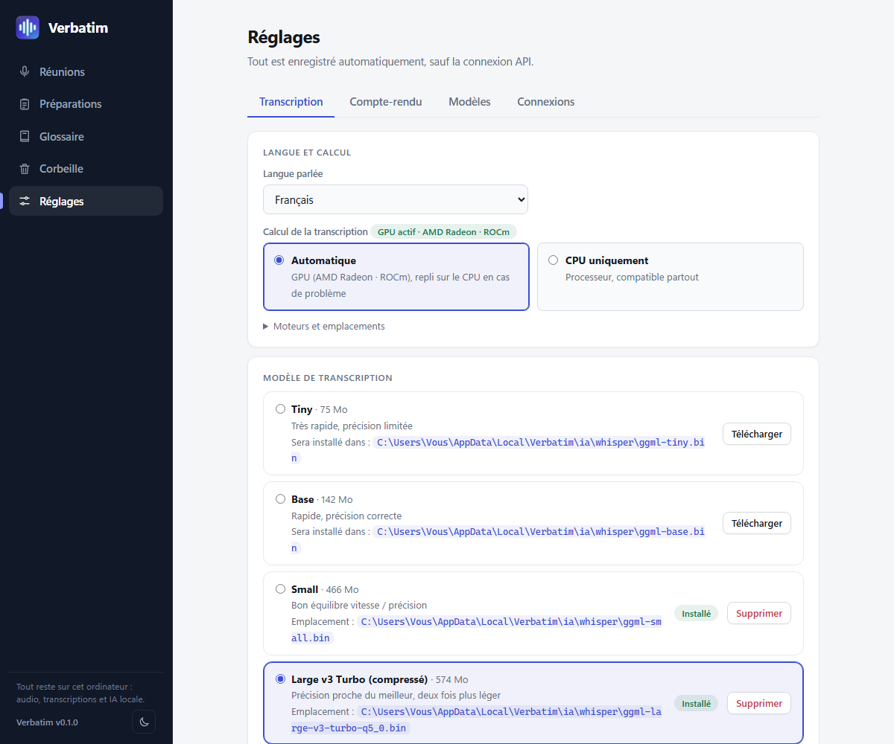

### Traduire

- **Traduction de la transcription** en 14 langues, par une IA locale (**TranslateGemma** de Google, ou le modèle du compte-rendu), avec les horodatages conservés : le lecteur et le surlignage fonctionnent aussi sur la traduction. Les exports (.txt, .srt, .vtt, .json) suivent la langue affichée.
- **Traduction en direct** sous chaque phrase de la transcription en direct.
- Calcul au choix (carte graphique ou processeur) dans Réglages › Traduction ; le matériel et le modèle utilisés sont affichés.

### Rédiger le compte-rendu

- Résumé, points abordés, décisions, actions et prochaines étapes, générés par une IA locale : **Qwen 3.5** (4B ou 9B), **Qwen 3.8 27B**, ou vos propres modèles GGUF. Ollama et une API compatible OpenAI restent possibles en option.
- Les réunions longues sont découpées en parties, résumées, puis fusionnées. Le glossaire et la préparation liée sont fournis au modèle.
- Sans modèle de rédaction, Verbatim produit un résumé simplifié à partir de phrases réelles de la transcription, sans rien inventer.
- Le modèle n'est chargé en mémoire que pendant la rédaction.
- **Langue du compte-rendu au choix**, indépendante de celle de la réunion (français, anglais, espagnol, allemand, italien, portugais, néerlandais), par défaut ou réunion par réunion.

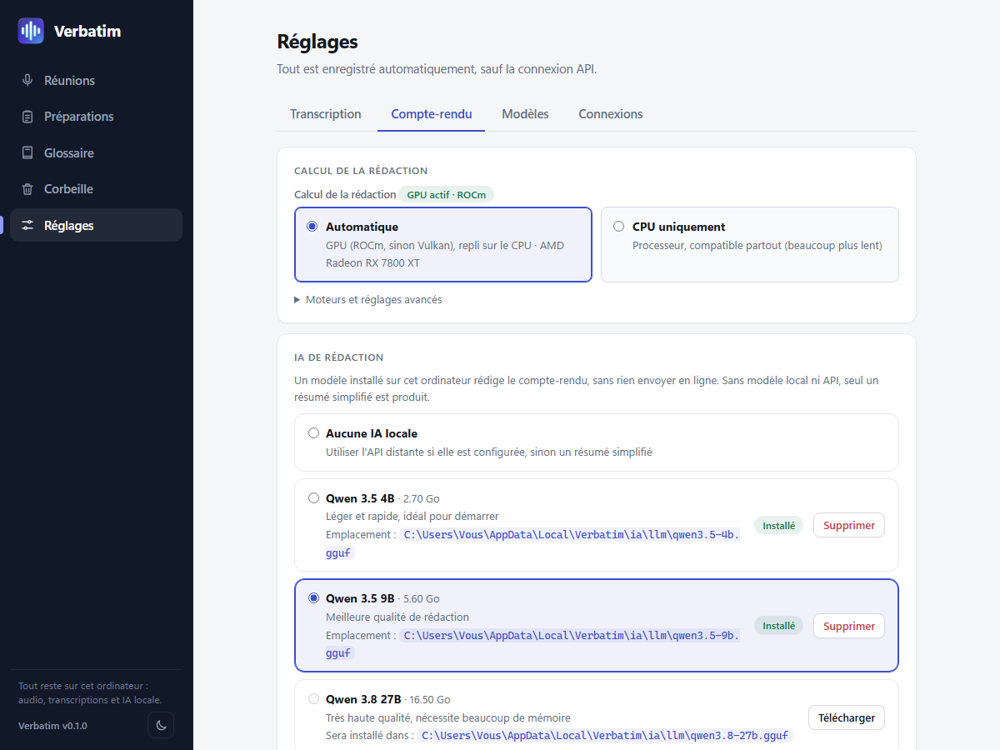

### Préparer et retrouver

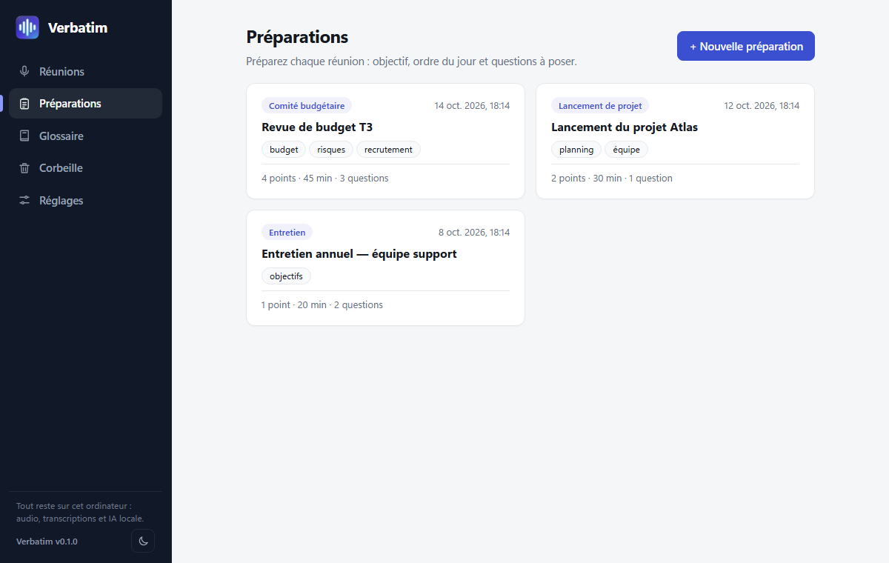

- **Préparations** : objectif, ordre du jour chronométré et questions à poser, avec des types de réunion personnalisables.
- **Lecteur audio synchronisé** (0,75× à 2×) : un clic sur un passage de la transcription lance la lecture à cet instant.
- **Export** en texte, sous-titres (.srt, .vtt), données (.json), compte-rendu (.md) et audio d'origine, dans la langue d'origine ou traduite.
- **Thème clair (par défaut), sombre ou automatique**, neuf palettes dont **Kawaii** et **Gamer**, interface en français et en anglais (Réglages › Général).

## Matériel pris en charge

| Carte graphique | Transcription (Whisper) | Rédaction (Qwen) |
|---|---|---|
| **NVIDIA** | CUDA | CUDA, sinon Vulkan |
| **AMD Radeon RX 7000 / PRO W7000** (RDNA 3) | ROCm | ROCm, sinon Vulkan |
| Autres AMD, Intel | Processeur | Vulkan |
| Sans carte graphique | Processeur | Processeur |

Le mode **Automatique** choisit le moteur le plus rapide disponible et revient sur le processeur en cas de problème. Les modèles trop volumineux pour la mémoire vidéo de votre carte sont signalés dans les Réglages.

### Whisper sur carte AMD : un build ROCm fait pour Verbatim

whisper.cpp ne fournit pas de binaire pour utiliser une carte AMD sous Windows : seules les versions processeur et NVIDIA (CUDA) sont publiées, et la transcription accélérée sur AMD n'est pas prévue clé en main. Verbatim comble ce manque :

- **whisper.cpp est compilé avec ROCm (HIP)** pour les Radeon RX 7000 / PRO W7000 (RDNA 3), avec le script `scripts/build-whisper-rocm.ps1`.
- **Un runtime ROCm minimal** est livré avec lui, pour que la carte fonctionne sans installer le SDK d'AMD.
- **Un `whisper-server` ROCm** assure aussi la transcription en direct sur ces cartes : une fenêtre de 10 s est traitée en 0,16 s, contre 1,2 s sur processeur.
- **L'installateur le met en place seul** quand il détecte une carte compatible, et le mode « Automatique » le choisit, avec repli sur le processeur en cas de problème.

Testé sur une RX 7800 XT.

## Performances et consommation

Mesures du 18 octobre 2026 sur un PC de bureau (Ryzen 7 5800X3D, 8 cœurs / 16 threads, 48 Go de RAM, Radeon RX 7800 XT 16 Go), avec un **enregistrement réel de 15 min 16 s en français**, aux mêmes réglages que l'application (Whisper Large v3 Turbo compressé ; Qwen 3.5 Q4_K_M ; 3 788 tokens lus et 300 écrits pour le compte-rendu). Données brutes : [`docs/benchmarks/results.json`](docs/benchmarks/results.json).

### En bref

| | Résultat |
|---|---|
| 🎙️ **Transcription** | 15 min 16 s transcrites en **41 s** sur carte AMD (×22,5 temps réel), contre 9 min 48 s sur processeur : **14× plus rapide** |
| 📝 **Compte-rendu** | **6 à 8 s** avec Qwen 3.5 4B ou 9B sur ROCm, contre 94 s pour le 4B sur processeur |
| 🧠 **Mémoire vidéo** | 1,2 Go pour Whisper, 3,4 Go pour le 4B, 5,7 Go pour le 9B : une carte de 8 Go suffit pour toute la chaîne |
| ⚙️ **Processeur** | 2 à 11 % du PC avec une carte graphique, contre 45 % sans |
| 💤 **Au repos** | 106 Mo réellement réservés, 0 % de processeur |

### Transcription

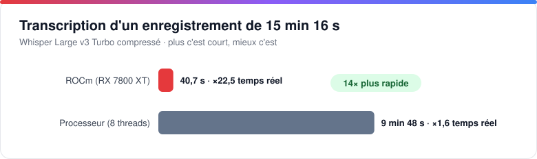

| Moteur | Durée | Vitesse | RAM (pic) | VRAM (pic) | Processeur |
|---|---:|---:|---:|---:|---|
| **ROCm** (RX 7800 XT) | **41 s** | ×22,5 temps réel | 405 Mo | 1,2 Go | ≈ 1,8 cœur (11 % du PC) |
| Processeur (8 threads) | 9 min 48 s | ×1,6 temps réel | 1,1 Go | – | ≈ 7,4 cœurs (46 % du PC) |

### Rédaction du compte-rendu

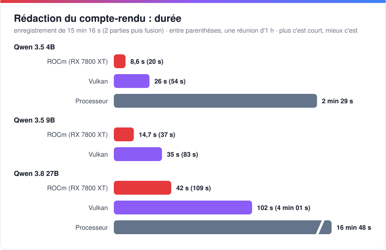

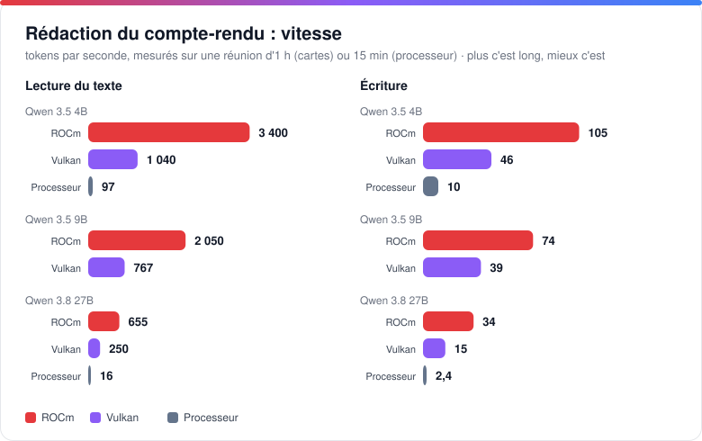

| Modèle · moteur | Durée | Lecture | Écriture | RAM (pic)¹ | VRAM (pic) | Processeur |
|---|---:|---:|---:|---:|---:|---:|
| 4B · **ROCm** | **6,4 s** | 1 909 tok/s | 74 tok/s | 3,1 Go (0,5 Go privés) | 3,4 Go | 4 % du PC |
| 4B · Vulkan | 14,9 s | 696 tok/s | 34 tok/s | 3,8 Go (1,2 Go privés) | 2,8 Go | 2 % du PC |
| 4B · Processeur | 94 s | 63 tok/s | 9 tok/s | 4,6 Go (1,9 Go privés) | – | 45 % du PC |
| 9B · **ROCm** | **8,4 s** | 1 330 tok/s | 56 tok/s | 5,4 Go (0,5 Go privés) | 5,7 Go | 4 % du PC |
| 9B · Vulkan | 19 s | 490 tok/s | 29 tok/s | 6,4 Go (1,5 Go privés) | 5,0 Go | 2 % du PC |

¹ La RAM comprend le fichier du modèle, mappé en mémoire par Windows : cette part est récupérable à tout moment. La mémoire réellement réservée par Verbatim (la colonne « Mémoire » du Gestionnaire des tâches) est la valeur entre parenthèses. Pour Whisper, seule la mémoire de travail totale a été relevée.

### Mémoire et processeur

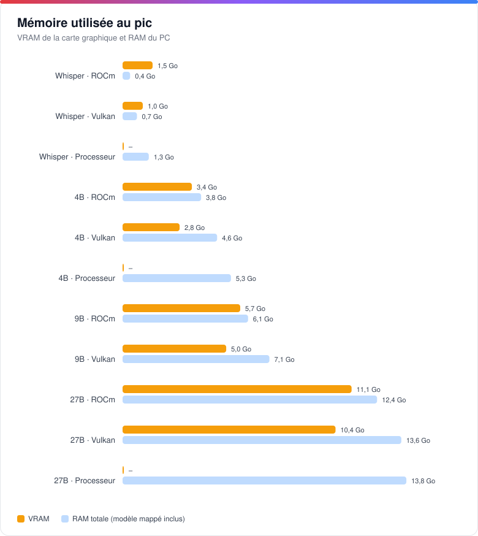

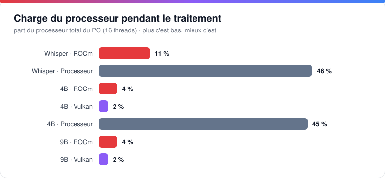

### L'application au repos

Fenêtre ouverte, sans traitement : environ **360 Mo** de mémoire de travail au total, dont **106 Mo** réellement réservés. La grande majorité est le moteur d'affichage de Windows (WebView2) ; le processus de Verbatim lui-même n'utilise qu'environ 30 Mo, et le processeur reste à 0 %. Les moteurs ne tournent que pendant une transcription ou une rédaction, et le modèle de rédaction est déchargé de la mémoire ensuite.

### Synthèse

**1. La carte graphique change l'usage.** Sur processeur, transcrire un enregistrement prend environ 64 % de sa durée (588 s pour 916 s) et mobilise 7 cœurs sur 16 : le PC reste utilisable, mais sollicité pendant près de dix minutes. Sur ROCm, la même transcription prend 41 s en n'occupant que 11 % du processeur. À proportion égale, une réunion d'une heure se transcrirait en environ 2 min 40 s sur ROCm, contre environ 38 min sur processeur (estimation linéaire à partir de cette mesure).

**2. ROCm ou Vulkan ?** Sur une Radeon RX 7000, ROCm termine le compte-rendu 2,3× plus vite que Vulkan (6,4 s contre 14,9 s pour le 4B ; 8,4 s contre 19 s pour le 9B). L'écart vient surtout de la lecture du texte (2,7×), et un peu moins de l'écriture (2×). Le prix est d'environ 0,6 à 0,7 Go de VRAM en plus (3,4 Go contre 2,8 Go ; 5,7 Go contre 5,0 Go). Vulkan reste le choix universel : il fonctionne sur AMD, NVIDIA et Intel, avec des performances déjà 6× supérieures au processeur pour le 4B.

**3. Qwen 3.5 4B ou 9B ?** Sur carte graphique, le 9B (plus de deux fois plus gros) ne coûte que 2 s de plus que le 4B sur ROCm (8,4 s contre 6,4 s, soit +31 %) : il offre une meilleure qualité de rédaction pour une attente à peine plus longue. Le 4B garde son intérêt sur les cartes de 4 à 6 Go de VRAM et sans carte graphique.

**4. Dimensionnement de la mémoire.** La transcription puis la rédaction se déroulent l'une après l'autre : la VRAM nécessaire est celle du plus gros des deux traitements, soit 5,7 Go pour le 9B sur ROCm. Une carte de 8 Go suffit donc pour toute la chaîne, une carte de 6 Go convient avec le 4B (3,4 Go). Côté RAM, une fois le modèle chargé dans la mémoire vidéo, Verbatim ne réserve qu'environ 0,5 Go ; sans carte graphique, il faut compter environ 1,5 Go de plus pour le 4B (1,9 Go réservés contre 0,5 Go).

**5. Sans carte graphique.** Le résultat reste exploitable : 94 s pour un compte-rendu avec le 4B, et une transcription qui dure environ les deux tiers de l'enregistrement. En revanche, le processeur est fortement sollicité (45 % du PC), et les modèles de transcription plus légers (Small, Base) sont à privilégier pour réduire l'attente.

**6. Quelle configuration choisir ?**

| Votre matériel | Transcription | Rédaction conseillée |
|---|---|---|
| Radeon RX 7000, 8 Go ou plus | ROCm | Qwen 3.5 9B · ROCm |
| Autre carte AMD ou Intel, 6 Go ou plus | Processeur | Qwen 3.5 9B · Vulkan |
| Carte de 4 à 6 Go | selon la carte | Qwen 3.5 4B · Vulkan ou ROCm |
| NVIDIA | CUDA | CUDA ou Vulkan (non mesuré) |
| Sans carte graphique | Processeur | Qwen 3.5 4B · Processeur |

**Limites de la mesure.** Une seule machine, un seul enregistrement et une exécution par configuration ; whisper.cpp v1.9.2 et llama.cpp b11700. Les résultats NVIDIA (CUDA) n'ont pas été mesurés, faute de carte sur la machine de test. Les écarts varient selon la machine, la longueur du texte et le contenu audio.

## Installation

1. **Téléchargez** `Verbatim_X.Y.Z_x64-setup.exe` depuis la [dernière release](https://github.com/Netapick/verbatim/releases/latest). L'installateur est léger (environ 3 Mo) et propose le français ou l'anglais.
2. **Lancez-le.** Il télécharge seul les moteurs : le pack de base (≈ 61 Mo), puis l'accélération adaptée à votre carte (ROCm ≈ 430 Mo, ou CUDA ≈ 1,3 Go). Il ne pose aucune question et ne demande pas de droits administrateur.
3. **Choisissez vos modèles** dans **Réglages** : un modèle de transcription et, si vous le souhaitez, un modèle de rédaction. Aucun modèle n'est livré avec l'application.

Les moteurs et les modèles sont rangés dans un dossier `ia` à côté de l'application. Si vous avez déjà des modèles (Ollama, fichiers `.gguf` ou `ggml-*.bin`), **Réglages › Modèles** les détecte et les **copie** dans `ia`, sans toucher aux originaux.

### Mises à jour automatiques

Au démarrage, Verbatim cherche la dernière version publiée sur GitHub, vérifie son empreinte SHA-256, l'installe, puis se relance. Cela n'arrive **jamais** pendant un enregistrement, une transcription ou une rédaction : une bannière propose alors la mise à jour. Désactivable dans **Réglages › Connexions**.

### Si votre antivirus bloque un moteur

Les moteurs tiers (whisper.cpp, llama.cpp) ne sont pas signés : certains antivirus, dont Windows Defender, peuvent les supprimer ou les bloquer (erreur « accès refusé » ou « connexion fermée »).

1. Ouvrez *Sécurité Windows › Protection contre les virus et menaces › Gérer les paramètres › Exclusions*.
2. Ajoutez le dossier d'installation de Verbatim (celui qui contient `ia`) comme exclusion.
3. Restaurez les fichiers dans *Historique de protection*, ou relancez le téléchargement depuis les Réglages.

Lancer l'application en administrateur n'aide pas.

## Confidentialité

| Ce qui reste sur votre ordinateur | Ce qui sort, et seulement si vous le demandez |
|---|---|
| Audio, transcriptions, comptes-rendus, préparations, glossaire, modèles | Téléchargement des moteurs et des modèles (GitHub, Hugging Face) |
| Toute la transcription et la rédaction | Recherche de mise à jour auprès de l'API GitHub (désactivable) |
| | Une API distante de rédaction, uniquement si vous la configurez vous-même |

Aucune donnée personnelle n'est collectée, et il n'y a aucune télémétrie. Texte complet : [politique de confidentialité](docs/PRIVACY.md).

## FAQ

**Faut-il une connexion Internet ?**
Seulement pour télécharger les moteurs et les modèles, et pour chercher les mises à jour. La transcription et la rédaction fonctionnent hors ligne.

**Faut-il une carte graphique ?**
Non. Verbatim fonctionne sur le processeur, mais une carte NVIDIA ou AMD accélère nettement la transcription et la rédaction.

**Quelle place et quelle mémoire faut-il ?**
Le pack de base pèse environ 61 Mo. Chaque modèle de transcription fait de 75 Mo à 1,1 Go, chaque modèle de rédaction de 2,7 à 16 Go environ, et chaque modèle de traduction (TranslateGemma) de 2,5 à 7,3 Go. Qwen 3.5 4B demande environ 4 Go de mémoire, le 9B environ 8 Go.

**Dans quelle langue sont les comptes-rendus ?**
Au choix : dans la langue de la réunion (par défaut) ou dans une autre, réglable par réunion. L'interface de Verbatim est disponible en français et en anglais, au choix à l'installation ou dans les Réglages.

**La traduction envoie-t-elle mon texte en ligne ?**
Non : elle utilise un modèle local, comme le compte-rendu. Seule exception : si vous avez configuré vous-même une API distante et qu'aucun modèle local n'est installé, c'est cette API qui est utilisée.

**Verbatim distingue-t-il les intervenants ?**
Pas encore : un seul « Intervenant » est affiché. C'est une piste de la [feuille de route](#feuille-de-route).

**Pourquoi Windows ou mon antivirus affiche-t-il un avertissement ?**
L'installateur et les moteurs ne sont pas encore signés. Voir la section sur l'[antivirus](#si-votre-antivirus-bloque-un-moteur) ; une demande de signature gratuite est en cours.

## Feuille de route

Ce sont des pistes de travail, sans engagement de date ni d'ordre.

**Réalisé**
- [x] **Interface en anglais** (français par défaut, choix dans Réglages › Général).
- [x] **Mise à jour automatique** depuis les releases GitHub.
- [x] **Moteurs GPU** : AMD (ROCm, Vulkan) et NVIDIA (CUDA).
- [x] **Langue du compte-rendu** au choix.
- [x] **Traduction de la transcription** en 14 langues (TranslateGemma).
- [x] **Transcription en direct** pendant la réunion, avec traduction en direct.
- [x] **Thèmes et palettes** (dont Kawaii et Gamer).

**Priorités**
- **Plus de langues d'interface** (espagnol, allemand, italien).
- **Séparation des intervenants** (diarisation) : attribuer chaque passage à son locuteur.
- **Whisper en Vulkan** : accélérer la transcription sur les cartes AMD d'avant la série RX 7000 et sur Intel.
- **Signature de code** de l'installateur (demande SignPath en cours), pour supprimer les avertissements de Windows.

**À l'étude**
- **Portage Android** : enregistrement et consultation sur téléphone, selon la faisabilité de l'exécution locale de Whisper et d'un petit modèle de rédaction.
- **Poser des questions à une réunion**, avec renvoi vers le passage concerné.
- **Recherche dans toutes les réunions** et **correction de la transcription** dans l'application.
- **Modèles de comptes-rendus personnalisables** (structure et ton).
- **Import de vidéos** et traitement par lots.
- **Enregistrement plus pratique** : raccourci global, icône dans la zone de notification, démarrage proposé à l'ouverture d'une visioconférence.
- **Amélioration audio** avant transcription, **sauvegarde et restauration** des réunions, **catalogue de modèles élargi** (Llama, Mistral, Gemma), **mode ligne de commande**, **macOS et Linux**.

Une idée ou un besoin ? Ouvrez une [issue](https://github.com/Netapick/verbatim/issues).

## Documentation

- [Présentation illustrée](docs/PRESENTATION.md) : le tour de l'application, avec captures d'écran.
- [Documentation technique](docs/DEVELOPMENT.md) : architecture, construction, distribution, mises à jour.
- [Historique des versions](CHANGELOG.md) : nouveautés de chaque version.
- [Signature du code](docs/SIGNATURE.md) · [Politique de confidentialité](docs/PRIVACY.md)

## Licence

Code sous licence [MIT](LICENSE). Les composants tiers (whisper.cpp, llama.cpp, ROCm) restent sous leurs licences respectives, détaillées dans `THIRD-PARTY-LICENSES.md` de chaque release.

### Code signing policy

Free code signing provided by [SignPath.io](https://signpath.io), certificate by [SignPath Foundation](https://signpath.org).

- Seul l'installateur construit depuis ce dépôt par GitHub Actions (`.github/workflows/release.yml`) est signé ; chaque signature est approuvée manuellement.
- Rôles : [Netapick](https://github.com/Netapick) est auteur, relecteur et approbateur (authentification multifacteur activée).
- Les moteurs tiers (whisper.cpp, llama.cpp) sont téléchargés tels que publiés par leurs auteurs et ne sont pas signés par ce projet.
