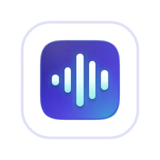
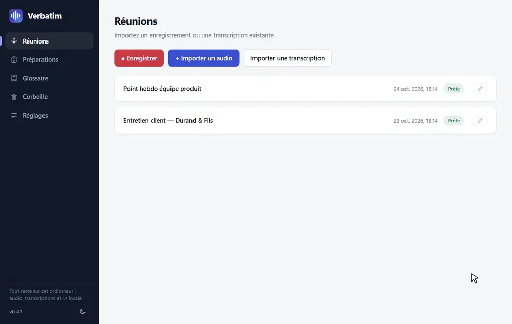
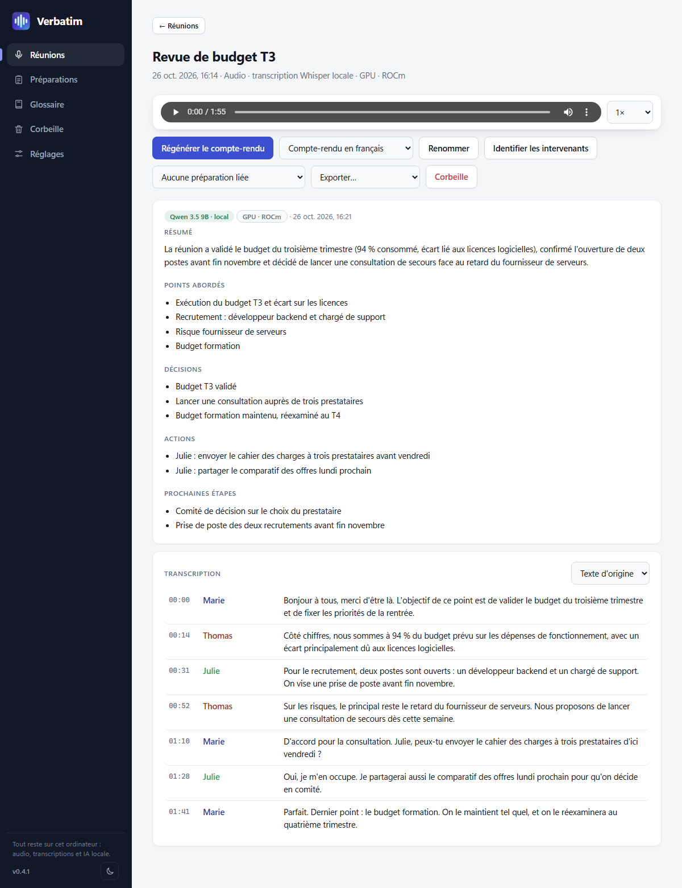

# Verbatim

### Vos réunions, transcrites et résumées. Chez vous, sur votre PC.

Verbatim enregistre ou importe vos réunions, les transcrit avec **Whisper**, identifie qui parle, puis rédige le compte-rendu avec une IA locale (**Qwen**, Gemma ou Ministral) qui tourne sur votre propre ordinateur. 
Aucun compte, aucun abonnement, aucune télémétrie : **rien ne quitte votre machine.**

     
     

**[Télécharger](https://github.com/Netapick/verbatim/releases/latest)** &nbsp;·&nbsp; [Installation](#installation) &nbsp;·&nbsp; [FAQ](#faq) &nbsp;·&nbsp; [Fonctionnalités](#fonctionnalités) &nbsp;·&nbsp; [Performances](#performances) &nbsp;·&nbsp; [Feuille de route](#feuille-de-route) &nbsp;·&nbsp; [Nouveautés](CHANGELOG.md)

Français · [English](README.en.md)

 

 Cliquez sur la vidéo pour la voir avec le son (40 s)

 

 

## Pourquoi Verbatim ?

| Atout | En pratique |
|---|---|
| **100 % local** | L'audio, les transcriptions, les comptes-rendus et les modèles restent sur votre ordinateur. Pas de cloud, pas de compte, pas d'envoi de données. |
| **Rapide grâce à votre carte graphique** | NVIDIA (CUDA, Vulkan) ou AMD (ROCm, Vulkan), avec repli automatique sur le processeur. Un enregistrement de 15 min est transcrit en **22 s** sur une RX 7800 XT, contre 4 min 38 s sur processeur. |
| **Qui a dit quoi** | Chaque passage est attribué à un intervenant, avec une couleur par personne. Ceux qui se présentent (« Bonjour, je suis Marie ») sont nommés tout au long de la réunion. |
| **Du son au compte-rendu** | Résumé, points abordés, décisions, actions et suites, à partir d'un simple enregistrement : de l'audio de 15 min au compte-rendu en 1 min 10 s sur une carte AMD récente. |
| **Pensé pour les réunions** | Transcription en direct, préparations (ordre du jour, questions), glossaire de sigles métier, traduction, lecteur audio synchronisé. |

## Comment ça marche

1. **Enregistrez** une réunion (micro, son du PC ou les deux) ou **importez** un audio ou une transcription existante (un simple glisser-déposer suffit).
2. **Transcrivez** : Whisper convertit la parole en texte minuté, localement.
3. **Identifiez** les intervenants : une couleur et un nom par personne, renommables en un clic.
4. **Rédigez** : une IA locale produit le compte-rendu, que vous relisez, exportez ou régénérez.

Au démarrage, Verbatim charge d'avance Whisper et la séparation des intervenants (un écran de démarrage suit l'avancement) : la première transcription n'attend pas. Tout est déchargé à la fermeture de l'application.

## Fonctionnalités

| | |
|---|---|
| **Enregistrer ou importer** | Micro, son du PC ou les deux ; enregistrement en arrière-plan avec pastille flottante ; import d'audio ou de transcription par glisser-déposer. |
| **Transcrire** | Whisper local, transcription en direct, glossaire de termes métier. |
| **Identifier les intervenants** | Une couleur et un nom par personne, corrigeables en un clic ou par sélection multiple. |
| **Traduire** | Transcription traduite en 14 langues, traduction en direct. |
| **Rédiger le compte-rendu** | Qwen, Gemma 4, Ministral 3 ou vos propres modèles GGUF ; langue au choix ; pause et reprise ; longueur proportionnelle à la durée. |
| **Retrouver** | Recherche dans toutes les réunions, lecteur audio synchronisé, exports, sauvegarde et restauration, corbeille. |
| **Confort** | Préparations de réunion, thèmes, interface en 5 langues, temps restant estimé, garde-fous à la fermeture. |

Le détail de chaque fonction, avec captures d'écran : **[Fonctionnalités](docs/FONCTIONNALITES.md)**.

## Matériel pris en charge

| Carte graphique | Transcription (Whisper) | Rédaction (Qwen) |
|---|---|---|
| **NVIDIA** | CUDA, sinon Vulkan | CUDA, sinon Vulkan |
| **AMD Radeon RX 7000 / PRO W7000** (RDNA 3) | ROCm | ROCm, sinon Vulkan |
| Autres AMD, Intel | Vulkan | Vulkan |
| Sans carte graphique | Processeur | Processeur |

Le mode **Automatique** choisit le moteur le plus rapide disponible et revient sur le processeur en cas de problème. Les modèles trop volumineux pour la mémoire vidéo de votre carte sont signalés dans les Réglages.

Whisper n'a pas de binaire officiel pour les cartes AMD sous Windows : Verbatim fournit ses propres builds (ROCm et Vulkan), décrits dans [Matériel et performances](docs/MATERIEL-ET-PERFORMANCES.md).

## Performances

Mesures du 25 octobre 2026 sur un PC de bureau (Ryzen 7 5800X3D, 48 Go de RAM, Radeon RX 7800 XT 16 Go), avec un enregistrement réel de 15 min 16 s en français et une réunion réelle d'1 heure.

| | Résultat |
|---|---|
| **Transcription** | 15 min 16 s transcrites en **22 s** sur ROCm (×41 le temps réel), 36 s sur Vulkan, 4 min 38 s sur processeur : **12× plus vite** avec une carte graphique |
| **Direct** | Un extrait de 10 s est transcrit en **0,4 s** (ROCm) ou 0,7 s (Vulkan) : le texte suit la voix. Sur processeur, 13 s : trop lent pour le direct |
| **Depuis la 0.3** | Transcription **1,5× plus rapide** sur ROCm (2,9× pour une réunion d'1 h), **9,7× plus rapide** sur les AMD d'avant la RX 7000 et les Intel, qui passent du processeur à Vulkan |
| **Intervenants** | 38 s pour 15 min, 2 min 30 s pour 1 h, sur le processeur (×24 le temps réel) |
| **Compte-rendu** | 15 min : **9 s** (4B, ROCm), 26 s (Vulkan), 2 min 29 s (processeur). Réunion d'1 h : 20 s (4B, ROCm). Le 27B : 42 s en ROCm, 17 min sur processeur |
| **Mémoire vidéo** | 1,5 Go pour Whisper, 3,4 Go pour le 4B, 5,7 Go pour le 9B (une carte de 8 Go suffit pour toute la chaîne), 11 Go pour le 27B |
| **Processeur** | 2 à 8 % du PC avec une carte graphique, contre 50 % sans |

Graphiques, tableaux complets, comparaison avec les versions précédentes et conseils de configuration : **[Matériel et performances](docs/MATERIEL-ET-PERFORMANCES.md)**.

## Installation

1. **Téléchargez** `Verbatim_X.Y.Z_x64-setup.exe` depuis la [dernière release](https://github.com/Netapick/verbatim/releases/latest). L'installateur est léger (environ 9 Mo) et propose le français ou l'anglais.
2. **Lancez-le.** Il télécharge seul les moteurs : le pack de base (≈ 61 Mo), puis l'accélération adaptée à votre carte (ROCm ≈ 430 Mo, Vulkan ≈ 17 Mo, ou CUDA ≈ 1,3 Go). Il ne pose aucune question et ne demande pas de droits administrateur.
3. **Choisissez vos modèles** dans **Réglages** : un modèle de transcription, un modèle de rédaction et, si vous le souhaitez, un modèle de traduction. Aucun modèle n'est livré avec l'application ; chacun n'est téléchargé qu'une seule fois, et un téléchargement peut être arrêté (le fichier partiel est alors supprimé). Au premier lancement, un message vous y conduit.

Les moteurs et les modèles sont rangés dans un dossier `ia` à côté de l'application. Si vous avez déjà des modèles (Ollama, fichiers `.gguf` ou `ggml-*.bin`), **Réglages › Modèles** les détecte et les **copie** dans `ia`, sans toucher aux originaux.

### Mises à jour automatiques

Au démarrage, Verbatim cherche la dernière version publiée sur GitHub. Un **bandeau** en haut l'annonce, avec ses notes. En cliquant sur **Mettre à jour**, une fenêtre au centre montre le téléchargement puis l'installation, et l'application redémarre toute seule. La signature de la mise à jour (minisign) est vérifiée avant l'installation.

Avec **Installer automatiquement** (Réglages › Général), la version est téléchargée en arrière-plan, mais **rien n'est installé sans votre clic** sur « Mettre à jour ». Le bouton reste grisé, avec la raison affichée, pendant un enregistrement, une transcription, une rédaction, une traduction ou un téléchargement.

### Si votre antivirus bloque un moteur

Les moteurs tiers (whisper.cpp, llama.cpp) ne sont pas signés : certains antivirus, dont Windows Defender, peuvent les supprimer ou les bloquer (erreur « accès refusé » ou « connexion fermée »).

1. Ouvrez *Sécurité Windows › Protection contre les virus et menaces › Gérer les paramètres › Exclusions*.
2. Ajoutez le dossier d'installation de Verbatim (celui qui contient `ia`) comme exclusion.
3. Restaurez les fichiers dans *Historique de protection*, ou relancez le téléchargement depuis les Réglages.

Lancer l'application en administrateur n'aide pas.

## Confidentialité

| Ce qui reste sur votre ordinateur | Ce qui sort, et seulement si vous le demandez |
|---|---|
| Audio, transcriptions, comptes-rendus, préparations, glossaire, modèles | Téléchargement des moteurs et des modèles (GitHub, Hugging Face) |
| Toute la transcription, la séparation des intervenants et la rédaction | Recherche de mise à jour auprès de l'API GitHub (désactivable) |
| Les voix des intervenants (calculées à la volée, non conservées) | Une API distante de rédaction, uniquement si vous la configurez vous-même |

Aucune donnée personnelle n'est collectée, et il n'y a aucune télémétrie. Texte complet : [politique de confidentialité](docs/PRIVACY.md).

## FAQ

**Faut-il une connexion Internet ?**
Seulement pour télécharger les moteurs et les modèles, et pour chercher les mises à jour. La transcription et la rédaction fonctionnent hors ligne.

**Faut-il une carte graphique ?**
Non. Verbatim fonctionne sur le processeur, mais une carte NVIDIA ou AMD accélère nettement la transcription et la rédaction (voir les [performances](#performances)).

**Quelle place et quelle mémoire faut-il ?**
Le pack de base pèse environ 61 Mo. Chaque modèle de transcription fait de 75 Mo à 1,1 Go, chaque modèle de rédaction de 2,1 à 19 Go environ, et chaque modèle de traduction (TranslateGemma) de 2,5 à 7,3 Go. Qwen 3.5 4B demande environ 4 Go de mémoire, le 9B environ 8 Go.

**Dans quelle langue sont les comptes-rendus ?**
Au choix : dans la langue de la réunion (par défaut) ou dans une autre, réglable par réunion. L'interface de Verbatim est disponible en français, anglais, espagnol, allemand et italien, au choix dans les Réglages (l'installateur est en français et en anglais).

**La traduction envoie-t-elle mon texte en ligne ?**
Non : elle utilise un modèle local, comme le compte-rendu. Seule exception : si vous avez configuré vous-même une API distante et qu'aucun modèle local n'est installé, c'est cette API qui est utilisée.

**Verbatim distingue-t-il les intervenants ?**
Oui : chaque passage est attribué à un intervenant, avec une couleur par personne, sans rien envoyer en ligne. Cliquez sur un nom pour le renommer. Le résultat reste approximatif quand des voix se ressemblent. Détails : [Fonctionnalités](docs/FONCTIONNALITES.md#identifier-les-intervenants).

**Pourquoi mon compte-rendu est-il court ?**
Sa longueur suit la durée de la réunion : un résumé de 5 à 8 phrases pour une réunion de 10 min au plus, puis davantage pour les réunions longues, avec des listes de sujets, décisions et actions. Les décisions et les actions ne sont listées que si elles sont dites explicitement ; la transcription complète reste toujours disponible à côté.

**Pourquoi Windows ou mon antivirus affiche-t-il un avertissement ?**
L'installateur et les moteurs n'ont pas de signature de code Windows. Voir la section sur l'[antivirus](#si-votre-antivirus-bloque-un-moteur) et la [signature](#signature).

## Feuille de route

Ce sont des pistes de travail, sans engagement de date ni d'ordre. Ce qui est déjà réalisé figure dans les [jalons](docs/FONCTIONNALITES.md#jalons-réalisés) et dans l'[historique des versions](CHANGELOG.md).

**À l'étude**
- **Portage Android** : enregistrement et consultation sur téléphone, selon la faisabilité de l'exécution locale de Whisper et d'un petit modèle de rédaction.
- **Poser des questions à une réunion**, avec renvoi vers le passage concerné.
- **Correction de la transcription** dans l'application.
- **Modèles de comptes-rendus personnalisables** (structure et ton).
- **Import de vidéos** et traitement par lots.
- **Enregistrement plus pratique** : raccourci global, démarrage proposé à l'ouverture d'une visioconférence.
- **Mode ligne de commande**, **macOS et Linux**.

Une idée ou un besoin ? Ouvrez une [issue](https://github.com/Netapick/verbatim/issues).

## Documentation

- [Fonctionnalités](docs/FONCTIONNALITES.md) : le détail de chaque fonction · [Matériel et performances](docs/MATERIEL-ET-PERFORMANCES.md) : cartes prises en charge, mesures.
- [Présentation illustrée](docs/PRESENTATION.md) : le tour de l'application, avec captures d'écran.
- [Documentation technique](docs/DEVELOPMENT.md) : architecture, construction, distribution, mises à jour.
- [Codes d'installation et messages d'erreur](docs/CODES.md) : que signifie chaque code ou message, et que faire.
- [Historique des versions](CHANGELOG.md) : nouveautés de chaque version.
- [Contribuer](CONTRIBUTING.md) : signaler un bug, proposer une idée ou du code · [Sécurité](SECURITY.md) : signaler une faille · [Code de conduite](CODE_OF_CONDUCT.md).
- [Signature du code](docs/SIGNATURE.md) · [Politique de confidentialité](docs/PRIVACY.md) · [Faux positifs antivirus](docs/FAUX-POSITIFS.md)

## Licence

Code sous licence [MIT](LICENSE). Les composants tiers (whisper.cpp, llama.cpp, ROCm) restent sous leurs licences respectives, détaillées dans `THIRD-PARTY-LICENSES.md` de chaque release.

### Signature

- L'installateur n'a pas de signature de code Windows (certificat) : Windows peut afficher un avertissement à l'installation.
- Les **mises à jour** de l'application sont signées par une clé minisign propre au projet, construites par GitHub Actions (`.github/workflows/release.yml`) ; la clé publique est dans `src-tauri/tauri.conf.json`. L'application refuse une mise à jour dont la signature est invalide.
- Les moteurs tiers (whisper.cpp, llama.cpp) sont téléchargés tels que publiés par leurs auteurs et ne sont pas signés par ce projet.
