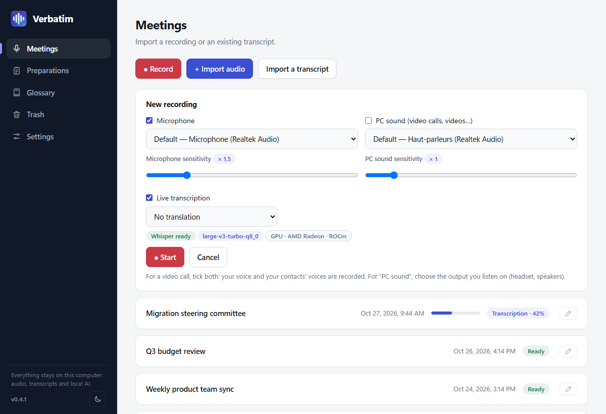
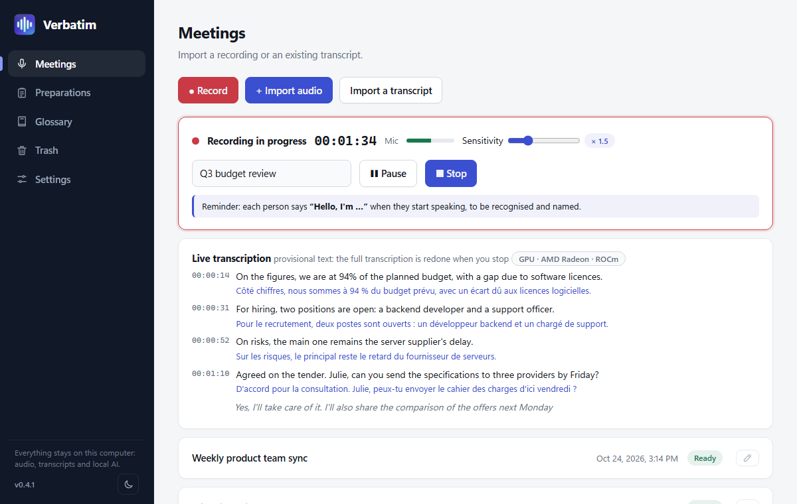
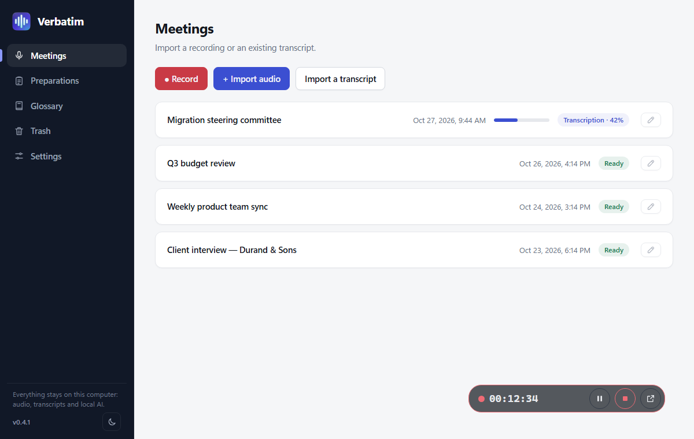
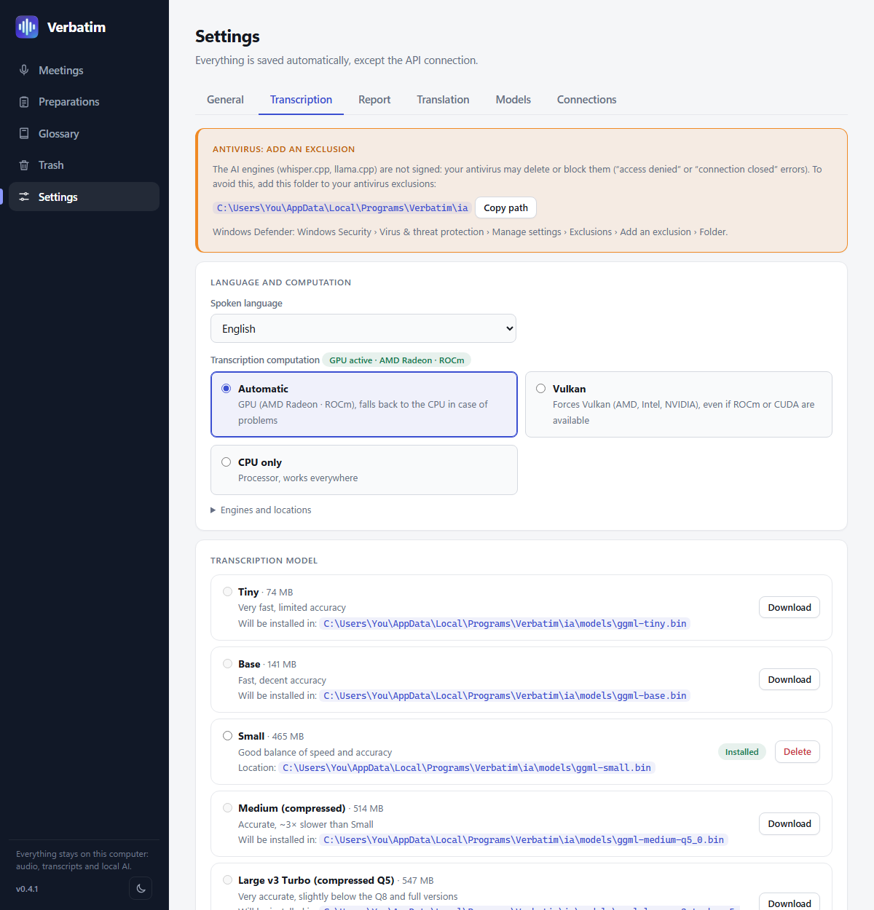
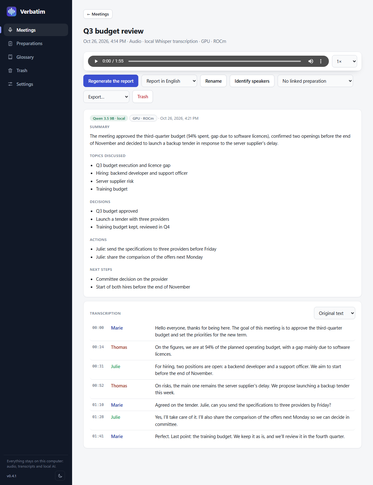
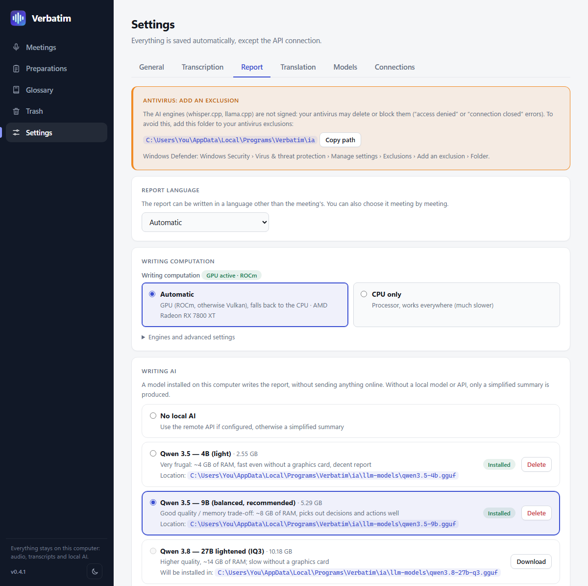
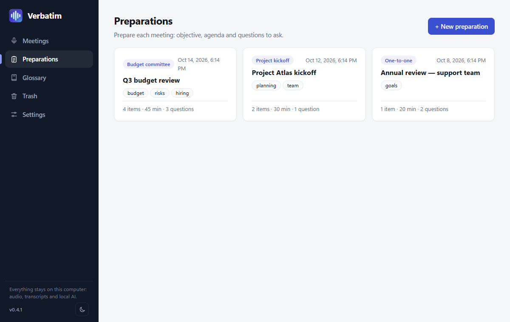

# Features

Every function in detail, with screenshots. ← [Back to the README](../README.en.md)

## Record or import

- Capture the **microphone**, the **PC sound** (video calls, videos, through WASAPI loopback) or both, mixed to mono. Live levels, pause and resume, sensitivity setting.
- Audio is written to disk as it is recorded: after a crash or a power cut, the recording is recovered at the next launch (about 2 seconds lost at most).
- **Background recording**: when it starts, the window hides (no taskbar button) and an opaque **bar** stays on top, docked by default in the taskbar, left of the notification area; a small button detaches it so you can move it freely on screen, with the clock, **pause / resume**, **stop** and a way back to the window. A **notification-area icon** offers the same actions (left click: show).
- Import **audio** (mp3, m4a/aac, ogg, flac, wav…) or an **existing transcript** (txt, srt, vtt, md), from the menu or by drag and drop.
- A message reminds you to **say hello** at the start of a recording: that is what lets Verbatim name the voices (can be turned off).

## Transcribe with Whisper

- Local Whisper (whisper.cpp), with speech detection to limit hallucinations on silences.
- French, English, Spanish, German, Italian, or automatic language detection.
- **Live transcription** (checkbox in the recording panel, unchecked by default): the text appears during the meeting, a few seconds behind; when you stop, the full transcript is redone for maximum quality.
- From the lightest model (Tiny, 75 MB) to the most accurate (Large v3), with compressed versions.
- A glossary of acronyms and business terms is passed to the model to limit errors on proper nouns.

## Identify the speakers

- After transcription, each passage is attributed to a speaker ("Speaker 1", "Speaker 2"…), with one color per person. The number of people is found automatically.
- Click a name: "Rename everywhere" changes the name throughout the meeting (transcript, translation, report, exports), "This passage only" fixes a passage attributed to the wrong person. The "Identify speakers" button handles a meeting that is already transcribed.
- To fix several passages at once, "Reassign passages" lets you select them (click, or Shift+click for a range) and assign them to a speaker; translations follow.
- If each person introduces themselves when they first speak, Verbatim remembers their voice and names it for the whole meeting.
- The work runs on the processor, with nothing sent online, about **24× faster than the audio** (38 s for 15 min, 2 min 30 s for 1 h). Very similar voices or very short sentences stay approximate.

## Translate

- **Transcript translation** into 14 languages, by a local AI (Google's **TranslateGemma**, or the report model), with timestamps kept: the player and highlighting also work on the translation. Exports (.txt, .srt, .vtt, .json) follow the displayed language.
- **Live translation** under each sentence of the live transcript.
- Compute on your choice of graphics card or processor in Settings › Translation; the hardware and model used are displayed.

## Write the report

- Summary, topics, decisions, actions and next steps, produced by a local AI of your choice: **Qwen** (3.5 in 4B or 9B, 3.8 in 27B, recommended model), **Gemma 4** (E4B, 12B, 26B-A4B), **Ministral 3** (3B, 8B, 14B), or your own GGUF models. In Settings › Report, a "Recommended models" card presents Qwen, and a drop-down list gives access to the other families. Ollama and an OpenAI-compatible API remain possible as options.
- Long meetings are split into parts, summarized, then merged. The glossary and the linked preparation are given to the model.
- The report's length is proportional to the meeting's duration: a 5 to 8 sentence summary for a meeting of 10 min or less, more detailed for long meetings.
- **Pause**: the Pause button stops the AI and frees video memory. **Resume** continues after the parts already analysed, even after the application has been closed; **Cancel** aborts. A short report starts again from scratch, and with Ollama or a remote API the pause only takes effect between two steps.
- Without a writing model, Verbatim produces a simplified summary built from real sentences of the transcript, inventing nothing.
- **Report language of your choice**, independent of the meeting's language (French, English, Spanish, German, Italian, Portuguese, Dutch), as a default or meeting by meeting.
- While the report is written, Whisper is released to leave memory to the AI; the writing model stays loaded while the application is open.

## Prepare and look back

- **Preparations**: objective, timed agenda and questions to ask, with customizable meeting types.
- **Synced audio player** (0.75× to 2×): a click on a passage of the transcript starts playback at that moment.
- **Rename** a meeting from the meeting itself or straight from the list.
- **Search**: a field at the top of the meetings list searches all meetings (titles, transcripts, reports), ignoring accents and case; clicking a result opens the meeting at the right passage. Inside a meeting, **Ctrl+F** searches the transcript and the report (Enter / Shift+Enter to move between results).
- **Export** as text, subtitles (.srt, .vtt), data (.json), report (.md) and the original audio, in the original or the translated language.
- **Backup and restore** (Settings › General): a single .zip file holds your meetings, preparations and glossary, with or without the audio files. Settings and the API key are not included. Restoring adds what is missing without changing or replacing what is already there: this is how you bring your meetings to another computer.
- **Trash**: an "Empty the trash" button empties it in one go.
- **Time remaining** estimate shown next to the percentages (transcription, speaker separation, report, translation, downloads and update).
- **Light (default), dark or automatic theme**, nine palettes including **Kawaii** and **Gamer**, interface in French, English, Spanish, German and Italian (Settings › General).
- **Safeguards**: if you close the application during a recording, a transcription or a report, it warns you before interrupting it.

## Milestones reached

- **Speaker separation** (diarization) and recognition of people who introduce themselves.
- **GPU engines**: AMD (ROCm, Vulkan) and NVIDIA (CUDA, Vulkan), including Whisper on Vulkan for AMD cards older than the RX 7000 series and Intel.
- **Built-in update**: banner, download and installation inside the application, automatic restart, verified signature.
- **Fast startup**: Whisper and speaker separation preloaded, a start screen, safeguards on close.
- **Interface in French, English, Spanish, German and Italian** (chosen in Settings › General).
- **Drag and drop** of audio files or transcripts.
- **Report language** of your choice, **transcript translation** into 14 languages, **live transcription** with translation.
- **Themes and palettes** (including Kawaii and Gamer).
- **Background recording**: floating bar (pause, stop) and notification-area icon.
- **Backup and restore** of meetings (a single .zip file, with or without audio), a button to empty the trash, a **wider model catalog** (Gemma 4, Ministral 3), reassigning passages to another speaker, a report whose length is proportional to the duration, report pause and time remaining estimate (version 0.5.0).
