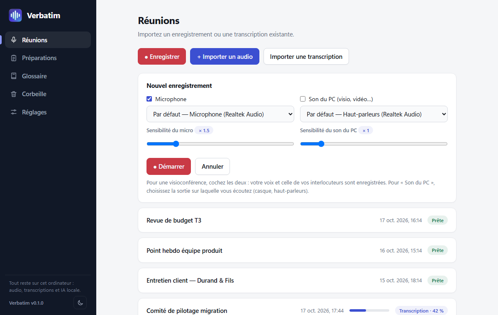
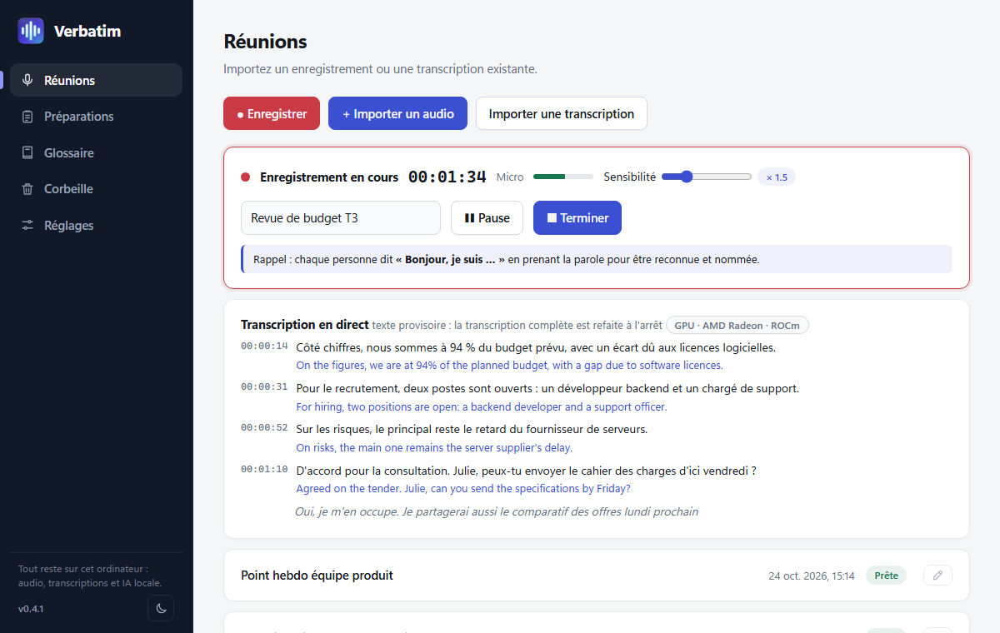
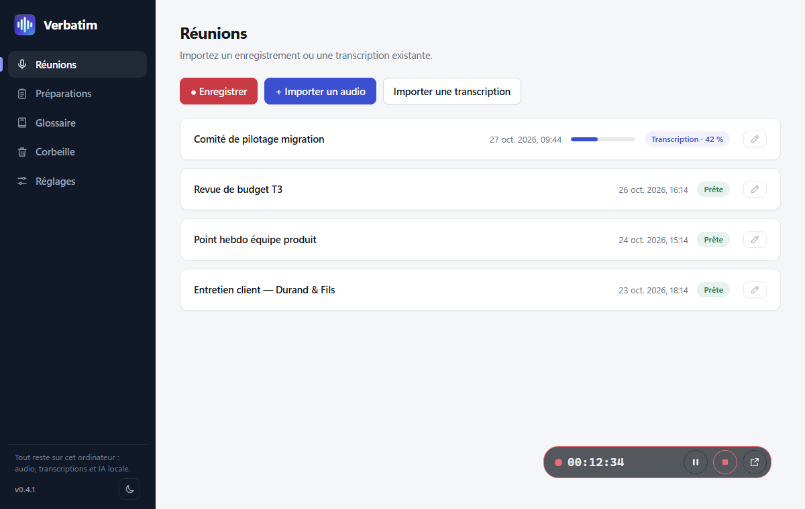
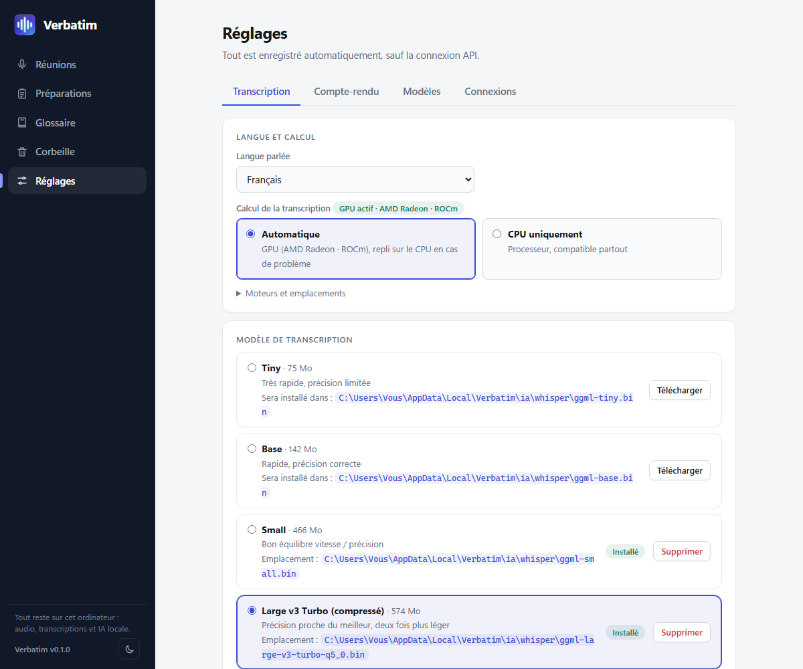
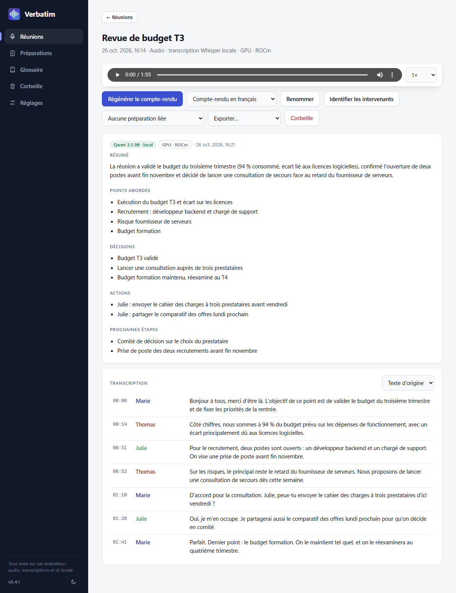
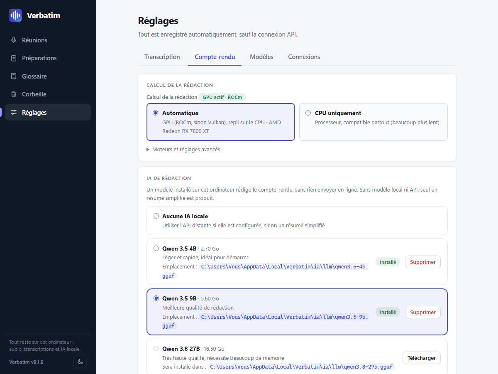
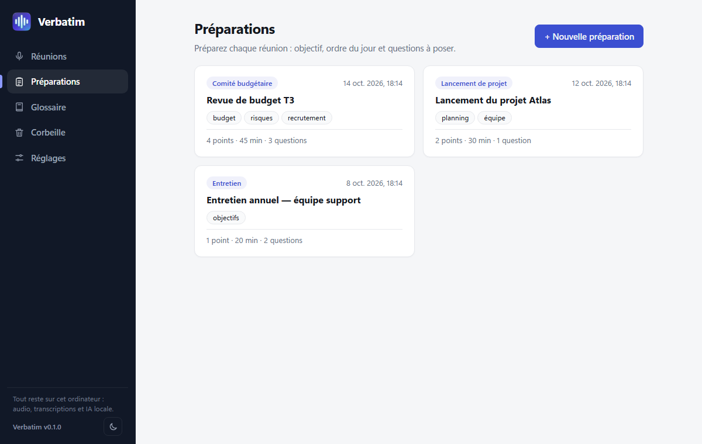

# Fonctionnalités

Le détail de chaque fonction, avec captures d'écran. ← [Retour au README](../README.md)

## Enregistrer ou importer

- Capture du **microphone**, du **son du PC** (visio, vidéo, via la boucle WASAPI) ou des deux, mixés en mono. Niveaux en direct, pause et reprise, réglage de la sensibilité.
- L'audio est écrit sur le disque au fil de l'eau : après un plantage ou une coupure, l'enregistrement est reconstitué au prochain lancement (environ 2 secondes perdues au plus).
- **Enregistrement en arrière-plan** : au démarrage, la fenêtre se masque (plus de bouton dans la barre des tâches) et une **pastille** opaque reste au premier plan, ancrée par défaut dans la barre des tâches, à gauche de la zone de notification ; un petit bouton la détache pour la déplacer librement dans l'écran, avec l'horloge, **pause / reprise**, **terminer** et le retour à la fenêtre. Une **icône dans la zone de notification** offre les mêmes actions (clic gauche : afficher).
- Import d'**audio** (mp3, m4a/aac, ogg, flac, wav…) ou d'une **transcription existante** (txt, srt, vtt, md), par le menu ou par glisser-déposer.
- Un message rappelle de **dire bonjour** en début d'enregistrement : c'est ce qui permet de nommer les voix (désactivable).

## Transcrire avec Whisper

- Whisper local (whisper.cpp), avec détection de parole pour limiter les hallucinations sur les silences.
- Français, anglais, espagnol, allemand, italien, ou détection automatique de la langue.
- **Transcription en direct** (case à cocher dans le panneau d'enregistrement, décochée par défaut) : le texte s'affiche pendant la réunion, avec quelques secondes de retard ; à l'arrêt, la transcription complète est refaite pour une qualité maximale.
- Du modèle le plus léger (Tiny, 75 Mo) au plus précis (Large v3), avec des versions compressées.
- Un glossaire de sigles et de termes métier est transmis au modèle pour limiter les erreurs sur les noms propres.

## Identifier les intervenants

- Après la transcription, chaque passage est attribué à un intervenant (« Intervenant 1 », « Intervenant 2 »…), avec une couleur par personne. Le nombre de personnes est trouvé automatiquement.
- Cliquez sur un nom : « Renommer partout » change le nom dans toute la réunion (transcription, traduction, compte-rendu, exports), « Ce passage seulement » corrige un passage attribué à la mauvaise personne. Le bouton « Identifier les intervenants » traite une réunion déjà transcrite.
- Pour corriger plusieurs passages d'un coup, « Réattribuer des passages » permet de les sélectionner (clic, Maj+clic pour un intervalle) et de les attribuer à un intervenant ; les traductions suivent.
- Si chaque personne se présente en prenant la parole, Verbatim retient sa voix et la nomme pour toute la réunion.
- Le calcul se fait sur le processeur, sans rien envoyer en ligne, environ **24× plus vite que l'audio** (38 s pour 15 min, 2 min 30 s pour 1 h). Les voix très proches ou les phrases très courtes restent approximatives.

## Traduire

- **Traduction de la transcription** en 14 langues, par une IA locale (**TranslateGemma** de Google, ou le modèle du compte-rendu), avec les horodatages conservés : le lecteur et le surlignage fonctionnent aussi sur la traduction. Les exports (.txt, .srt, .vtt, .json) suivent la langue affichée.
- **Traduction en direct** sous chaque phrase de la transcription en direct.
- Calcul au choix (carte graphique ou processeur) dans Réglages › Traduction ; le matériel et le modèle utilisés sont affichés.

## Rédiger le compte-rendu

- Résumé, points abordés, décisions, actions et prochaines étapes, générés par une IA locale au choix : **Qwen** (3.5 en 4B ou 9B, 3.8 en 27B, modèle recommandé), **Gemma 4** (E4B, 12B, 26B-A4B), **Ministral 3** (3B, 8B, 14B), ou vos propres modèles GGUF. Dans Réglages › Compte-rendu, une carte « Modèles recommandés » présente Qwen, et une liste déroulante donne accès aux autres familles. Ollama et une API compatible OpenAI restent possibles en option.
- Les réunions longues sont découpées en parties, résumées, puis fusionnées. Le glossaire et la préparation liée sont fournis au modèle.
- Le compte-rendu est proportionné à la durée : un résumé de 5 à 8 phrases pour une réunion de 10 min au plus, plus détaillé pour les réunions longues.
- **Pause** : le bouton Pause arrête l'IA et libère la mémoire vidéo. **Reprendre** continue après les parties déjà analysées, même après la fermeture de l'application ; **Abandonner** annule. Un compte-rendu court repart de zéro, et avec Ollama ou une API distante la pause ne prend effet qu'entre deux étapes.
- Sans modèle de rédaction, Verbatim produit un résumé simplifié à partir de phrases réelles de la transcription, sans rien inventer.
- **Langue du compte-rendu au choix**, indépendante de celle de la réunion (français, anglais, espagnol, allemand, italien, portugais, néerlandais), par défaut ou réunion par réunion.
- Pendant la rédaction, Whisper est libéré pour laisser la mémoire à l'IA ; le modèle de rédaction reste chargé tant que l'application est ouverte.

## Préparer et retrouver

- **Préparations** : objectif, ordre du jour chronométré et questions à poser, avec des types de réunion personnalisables.
- **Lecteur audio synchronisé** (0,75× à 2×) : un clic sur un passage de la transcription lance la lecture à cet instant.
- **Renommer** une réunion depuis la réunion ou directement dans la liste.
- **Recherche** : un champ en haut de la liste des réunions cherche dans toutes les réunions (titres, transcriptions, comptes-rendus), sans tenir compte des accents ni de la casse ; un clic sur un résultat ouvre la réunion au bon passage. Dans une réunion, **Ctrl+F** cherche dans la transcription et le compte-rendu (Entrée / Maj+Entrée pour passer d'un résultat à l'autre).
- **Export** en texte, sous-titres (.srt, .vtt), données (.json), compte-rendu (.md) et audio d'origine, dans la langue d'origine ou traduite.
- **Sauvegarde et restauration** (Réglages › Général) : un seul fichier .zip contient vos réunions, préparations et glossaire, avec ou sans l'audio. Les réglages et la clé d'API n'y sont pas. La restauration ajoute ce qui manque sans rien modifier ni remplacer ce qui est déjà présent : c'est ainsi que l'on retrouve ses réunions sur un autre ordinateur.
- **Corbeille** : un bouton « Vider la corbeille » permet de la vider d'un coup.
- **Temps restant** estimé affiché à côté des pourcentages (transcription, séparation des intervenants, compte-rendu, traduction, téléchargements et mise à jour).
- **Thème clair (par défaut), sombre ou automatique**, neuf palettes dont **Kawaii** et **Gamer**, interface en français, anglais, espagnol, allemand et italien (Réglages › Général).
- **Garde-fous** : si vous fermez l'application pendant un enregistrement, une transcription ou une rédaction, elle vous prévient avant de l'interrompre.

## Jalons réalisés

- **Séparation des intervenants** (diarisation) et reconnaissance de ceux qui se présentent.
- **Moteurs GPU** : AMD (ROCm, Vulkan) et NVIDIA (CUDA, Vulkan), y compris Whisper en Vulkan pour les AMD d'avant la série RX 7000 et Intel.
- **Mise à jour intégrée** : bandeau, téléchargement et installation dans l'application, redémarrage automatique, signature vérifiée.
- **Démarrage rapide** : Whisper et la séparation préchargés, écran de démarrage, garde-fous à la fermeture.
- **Interface en français, anglais, espagnol, allemand et italien** (choix dans Réglages › Général).
- **Glisser-déposer** de fichiers audio ou de transcriptions.
- **Langue du compte-rendu** au choix, **traduction** de la transcription en 14 langues, **transcription en direct** avec traduction.
- **Thèmes et palettes** (dont Kawaii et Gamer).
- **Enregistrement en arrière-plan** : pastille flottante (pause, terminer) et icône dans la zone de notification.
- **Sauvegarde et restauration** des réunions (un fichier .zip, avec ou sans l'audio), bouton pour vider la corbeille, **catalogue de modèles élargi** (Gemma 4, Ministral 3), réattribution des passages à un autre intervenant, compte-rendu proportionné à la durée, pause du compte-rendu et temps restant estimé (version 0.5.0).
