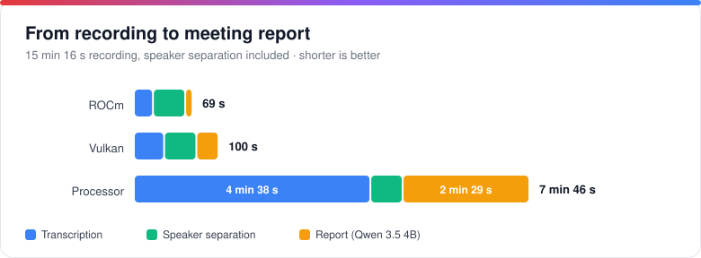
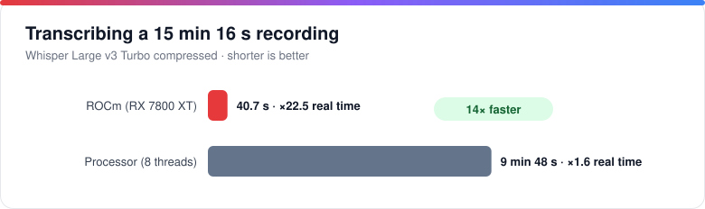
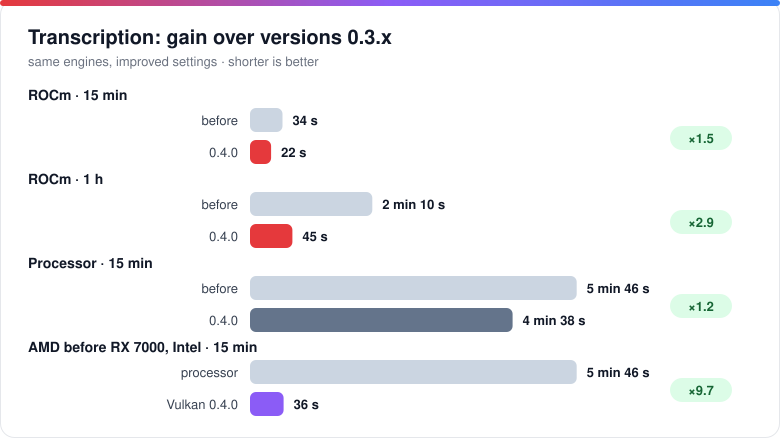
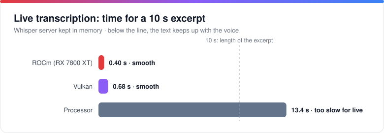
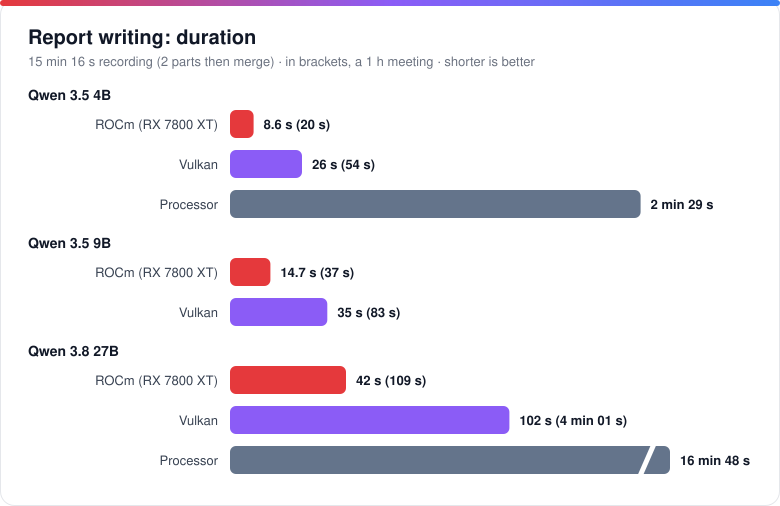
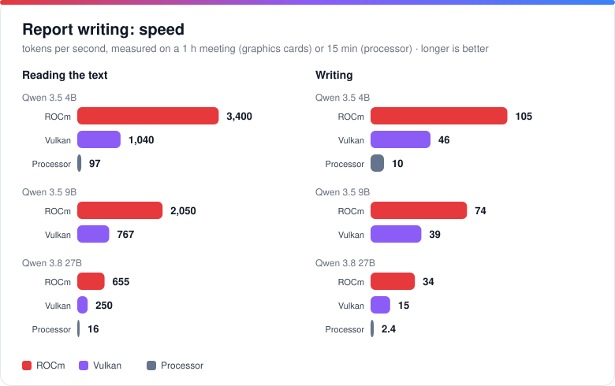
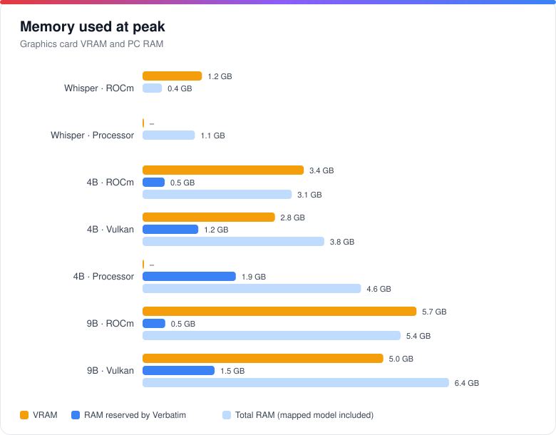
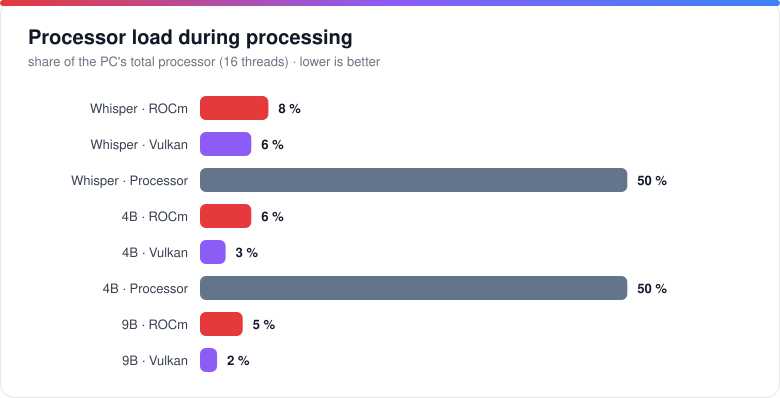

# Hardware and performance

The supported graphics cards and the detailed measurements (transcription, live, writing, memory). ← [Back to the README](../README.en.md)

## Supported hardware

| Graphics card | Transcription (Whisper) | Writing (Qwen) |
|---|---|---|
| **NVIDIA** | CUDA, otherwise Vulkan | CUDA, otherwise Vulkan |
| **AMD Radeon RX 7000 / PRO W7000** (RDNA 3) | ROCm | ROCm, otherwise Vulkan |
| Other AMD, Intel | Vulkan | Vulkan |
| No graphics card | Processor | Processor |

**Automatic** mode picks the fastest engine available and falls back to the processor if there is a problem. Models too large for your card's video memory are flagged in Settings.

### Whisper on AMD cards: builds made for Verbatim

whisper.cpp does not ship a binary to use an AMD card on Windows: only processor and NVIDIA (CUDA) versions are published. Verbatim fills the gap with two in-house builds:

- **ROCm (HIP)** for Radeon RX 7000 / PRO W7000 (RDNA 3), the fastest: script `scripts/build-whisper-rocm.ps1`, shipped with a minimal ROCm runtime (no need for AMD's SDK).
- **Vulkan** for other AMD cards and Intel: script `scripts/build-whisper-vulkan.ps1`, a 17 MB pack, with no embedded runtime (your driver provides Vulkan).
- Each exists as `whisper-cli` (files) and `whisper-server` (**live transcription**).
- **The installer sets up the right pack by itself**, and "Automatic" mode picks it, with fallback to the processor if there is a problem.

Tested on an RX 7800 XT.

## Performance

Measurements of 25 October 2026 on a desktop PC (Ryzen 7 5800X3D, 8 cores / 16 threads, 48 GB RAM, Radeon RX 7800 XT 16 GB), with a **real 15 min 16 s recording in French** and a real **1-hour** meeting, with the application's settings (version 0.4.0: Whisper Large v3 Turbo compressed, Qwen 3.5 Q4_K_M). Raw data: [`docs/benchmarks/results.json`](benchmarks/results.json).

### At a glance

| | Result |
|---|---|
| **Transcription** | 15 min 16 s transcribed in **22 s** on ROCm (×41 real time), 36 s on Vulkan, 4 min 38 s on the processor: **12× faster** with a graphics card |
| **Live** | A 10 s excerpt is transcribed in **0.4 s** (ROCm) or 0.7 s (Vulkan): the text keeps up with the voice. On the processor, 13 s: too slow for live |
| **Since 0.3** | Transcription **1.5× faster** on ROCm (2.9× for a 1-hour meeting), **9.7× faster** on AMD cards older than the RX 7000 and on Intel, which move from the processor to Vulkan |
| **Speakers** | 38 s for 15 min, 2 min 30 s for 1 h, on the processor (×24 real time) |
| **Report** | 15 min: **9 s** (4B, ROCm), 26 s (Vulkan), 2 min 29 s (processor). 1-hour meeting: 20 s (4B, ROCm). The 27B: 42 s on ROCm, 17 min on the processor |
| **Video memory** | 1.5 GB for Whisper, 3.4 GB for the 4B, 5.7 GB for the 9B (an 8 GB card is enough for the whole chain), 11 GB for the 27B |
| **Processor** | 2 to 8% of the PC with a graphics card, versus 50% without |

### From recording to report

Total for the 15 min 16 s recording: transcription + speaker separation + report (Qwen 3.5 4B), the sum of the steps measured one by one.

### Transcription

| Engine | Time | Speed | RAM (peak) | VRAM (peak) | Processor |
|---|---:|---:|---:|---:|---|
| **ROCm** (RX 7800 XT) | **22 s** | ×41 real time | 367 MB | 1.5 GB | ≈ 1.3 core (8% of the PC) |
| Vulkan | 36 s | ×26 real time | 699 MB | 1.0 GB | ≈ 1 core (6% of the PC) |
| Processor (8 threads) | 4 min 38 s | ×3.3 real time | 1.3 GB | – | ≈ 8 cores (50% of the PC) |

Proportionally, a one-hour meeting would be transcribed in about 1 min 30 s on ROCm, 2 min 20 s on Vulkan and 18 min on the processor (linear estimate).

### Gain over previous versions

The engines are the same as before (whisper.cpp 1.9.2, llama.cpp b11700): the gain comes from the settings and options of 0.4.0, measured on the same machine with the same model.

| Case (transcription) | Versions 0.3.x | 0.4.0 | Gain | What changed |
|---|---:|---:|---:|---|
| ROCm · 15 min | 34 s | **22 s** | ×1.5 | greedy decoding (`-bs 1`), almost identical text (2% word difference) |
| ROCm · 1 h | 2 min 10 s | **45 s** | ×2.9 | same, and audio split into 3 parts processed in parallel (4.4 GB of VRAM instead of 1.5 GB) |
| Processor · 15 min | 5 min 46 s | **4 min 38 s** | ×1.2 | greedy decoding |
| AMD before RX 7000, Intel · 15 min | 5 min 46 s (processor) | **36 s** (Vulkan) | ×9.7 | Whisper on Vulkan: these cards were not used before |
| AMD before RX 7000, Intel · 1 h | ≈ 23 min (processor, linear estimate) | **2 min 11 s** (Vulkan) | ×10 | same |

For the report, the model now stays loaded in memory while the application is open: it is no longer read from disk for every report, which saves **3 to 5 s** for the 4B and 9B, and **5 to 32 s** for the 27B (the largest, especially the first time). Whisper is also preloaded at startup, which removes the wait before a recording with live transcription.

### Live transcription

The Whisper server loads in 1 to 1.6 s (it is preloaded at startup) and stays in memory: 94 MB of RAM and 1.4 GB of VRAM on ROCm, 335 MB and 1.0 GB on Vulkan, 920 MB on the processor.

### Report writing

| Model · engine | 15 min | 1 h | Reading | Writing | RAM (peak)¹ | VRAM (peak) | Processor |
|---|---:|---:|---:|---:|---:|---:|---:|
| 4B · **ROCm** | **8.6 s** | 20 s | 3,400 tok/s | 105 tok/s | 3.8 GB | 3.4 GB | 6% of the PC |
| 4B · Vulkan | 26 s | 54 s | 1,040 tok/s | 46 tok/s | 4.6 GB | 2.8 GB | 3% of the PC |
| 4B · Processor | 2 min 29 s | – | 97 tok/s | 10 tok/s | 5.3 GB | – | 50% of the PC |
| 9B · **ROCm** | **15 s** | 37 s | 2,050 tok/s | 74 tok/s | 6.1 GB | 5.7 GB | 5% of the PC |
| 9B · Vulkan | 35 s | 83 s | 767 tok/s | 39 tok/s | 7.1 GB | 5.0 GB | 2% of the PC |
| 27B · **ROCm** | **42 s** | 1 min 49 s | 655 tok/s | 34 tok/s | 12.4 GB | 11.1 GB | 4% of the PC |
| 27B · Vulkan | 1 min 42 s | 4 min 1 s | 250 tok/s | 15 tok/s | 13.6 GB | 10.4 GB | 2% of the PC |
| 27B · Processor | 16 min 48 s | – | 16 tok/s | 2.4 tok/s | 13.8 GB | – | 50% of the PC |

The application is measured as it really runs: the 15 min recording is split into 2 parts summarized one by one (≈ 9,900 tokens read, 550 to 1,100 written), then merged; the 1-hour meeting is split into 6 parts (≈ 25,000 tokens read). The 27B model tested is the lightened version (IQ3, 10.9 GB). Times are those of the **first report after the model has loaded**: a second report is up to twice as fast (the engine is already "warm").

¹ RAM includes the model file, memory-mapped by Windows: that part can be reclaimed at any time.

### Memory and processor

### Key takeaways

**1. The graphics card changes how you use it.** On the processor, transcribing a recording uses 8 of 16 cores for nearly a third of its duration, and the whole path (transcription, speakers, report) takes 7 min 46 s for 15 min of audio. On ROCm it takes 1 min 9 s while using only a few percent of the processor: the PC stays usable.

**2. ROCm or Vulkan?** On a Radeon RX 7000, ROCm transcribes 1.6× faster than Vulkan and writes 2 to 3× faster. Vulkan uses a little less video memory (0.5 to 0.7 GB less) and remains the universal choice: it works on AMD, NVIDIA and Intel, and is still 6× faster than the processor for writing with the 4B.

**3. Qwen 3.5 4B or 9B?** On ROCm, the 9B costs about 6 s more than the 4B for 15 min, 17 s more for 1 h. It writes slightly more detail (more actions and next steps picked up in our tests). The 4B stays useful on cards with 4 to 6 GB of VRAM and with no graphics card. The **27B** (42 s on ROCm for 15 min, 1 min 49 s for 1 h) writes fuller reports (220 to 330 words against 120 to 250) and picks up decisions and next steps that the small models miss; it needs about 11 GB of VRAM, i.e. a 16 GB card, and is unusable on the processor (nearly 17 min).

**4. Sizing memory.** Whisper is released while the report is written: the VRAM you need is that of the larger of the two jobs, i.e. 5.7 GB for the 9B on ROCm. An 8 GB card is therefore enough for the whole chain, a 6 GB card works with the 4B (3.4 GB), and the 27B needs a 16 GB card (11.1 GB).

**5. With no graphics card.** The result is still usable: 4 min 38 s of transcription, 38 s of speaker separation and 2 min 29 s of report (4B) for 15 min of audio. However the processor is heavily used (50% of the PC) and live transcription is too slow: lighter transcription models (Small, Base) are preferable.

**6. Which configuration should you pick?**

| Your hardware | Transcription | Recommended writing |
|---|---|---|
| Radeon RX 7000, 16 GB | ROCm | Qwen 3.8 27B · ROCm (most detailed) or Qwen 3.5 9B · ROCm |
| Radeon RX 7000, 8 GB or more | ROCm | Qwen 3.5 9B · ROCm |
| Other AMD or Intel card, 6 GB or more | Vulkan | Qwen 3.5 9B · Vulkan |
| Card with 4 to 6 GB | depends on the card | Qwen 3.5 4B · Vulkan or ROCm |
| NVIDIA | CUDA | CUDA or Vulkan (not measured) |
| No graphics card | Processor | Qwen 3.5 4B · Processor |

**Limits of the measurement.** One machine and one recording (transcription: average of 2 runs, a single one for the processor; comparison with versions 0.3.x: same binaries, old settings replayed, one run for 1 h); whisper.cpp v1.9.2, llama.cpp b11700. NVIDIA (CUDA) results were not measured, as the test machine has no such card. Speaker separation was timed on a single-voice recording: its speed does not depend on the number of people, but the quality of the result is not evaluated here. Gaps vary with the machine, the length of the text and the audio content.

