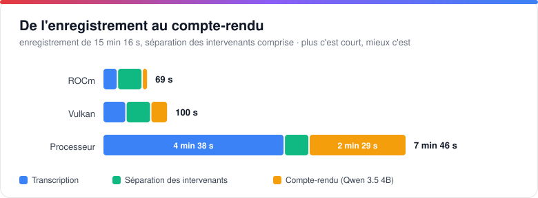
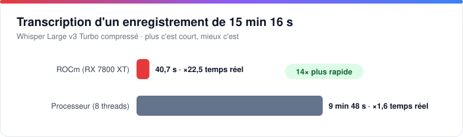
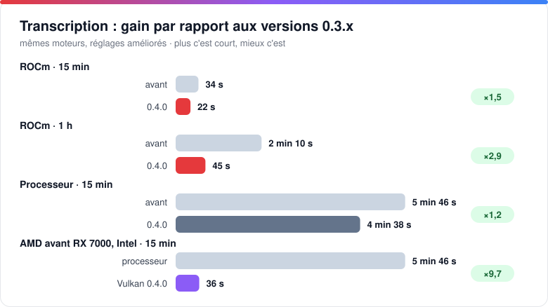
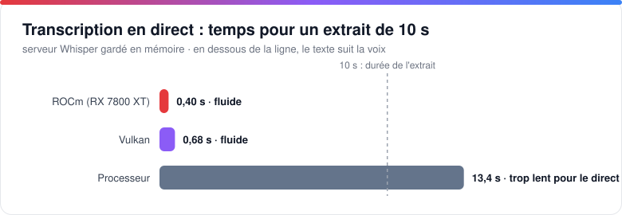
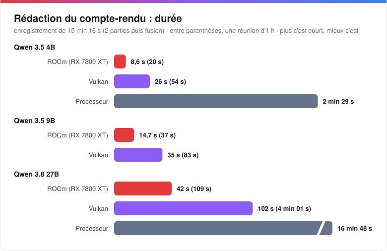
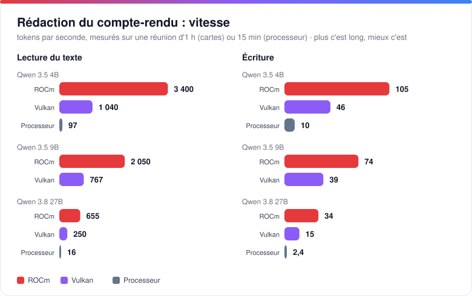
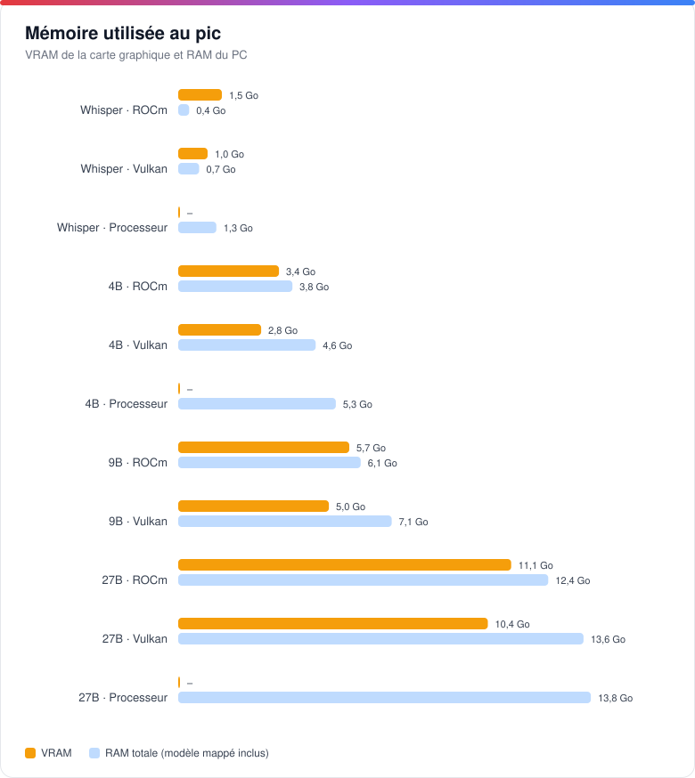
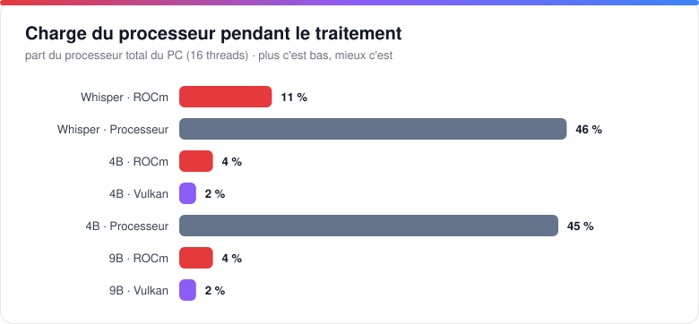

# Matériel et performances

Les cartes graphiques prises en charge et les mesures détaillées (transcription, direct, rédaction, mémoire). ← [Retour au README](../README.md)

## Matériel pris en charge

| Carte graphique | Transcription (Whisper) | Rédaction (Qwen) |
|---|---|---|
| **NVIDIA** | CUDA, sinon Vulkan | CUDA, sinon Vulkan |
| **AMD Radeon RX 7000 / PRO W7000** (RDNA 3) | ROCm | ROCm, sinon Vulkan |
| Autres AMD, Intel | Vulkan | Vulkan |
| Sans carte graphique | Processeur | Processeur |

Le mode **Automatique** choisit le moteur le plus rapide disponible et revient sur le processeur en cas de problème. Les modèles trop volumineux pour la mémoire vidéo de votre carte sont signalés dans les Réglages.

### Whisper sur carte AMD : des builds faits pour Verbatim

whisper.cpp ne fournit pas de binaire pour utiliser une carte AMD sous Windows : seules les versions processeur et NVIDIA (CUDA) sont publiées. Verbatim comble ce manque avec deux builds maison :

- **ROCm (HIP)** pour les Radeon RX 7000 / PRO W7000 (RDNA 3), le plus rapide : script `scripts/build-whisper-rocm.ps1`, avec un runtime ROCm minimal livré avec lui (pas besoin du SDK d'AMD).
- **Vulkan** pour les autres AMD et les Intel : script `scripts/build-whisper-vulkan.ps1`, un pack de 17 Mo, sans runtime embarqué (le pilote fournit Vulkan).
- Chacun existe en `whisper-cli` (fichiers) et en `whisper-server` (**transcription en direct**).
- **L'installateur met en place le bon pack seul**, et le mode « Automatique » le choisit, avec repli sur le processeur en cas de problème.

Testé sur une RX 7800 XT.

## Performances

Mesures du 25 octobre 2026 sur un PC de bureau (Ryzen 7 5800X3D, 8 cœurs / 16 threads, 48 Go de RAM, Radeon RX 7800 XT 16 Go), avec un **enregistrement réel de 15 min 16 s en français** et une réunion réelle d'**1 heure**, aux réglages de l'application (version 0.4.0 : Whisper Large v3 Turbo compressé, Qwen 3.5 Q4_K_M). Données brutes : [`docs/benchmarks/results.json`](benchmarks/results.json).

### En bref

| | Résultat |
|---|---|
| **Transcription** | 15 min 16 s transcrites en **22 s** sur ROCm (×41 le temps réel), 36 s sur Vulkan, 4 min 38 s sur processeur : **12× plus vite** avec une carte graphique |
| **Direct** | Un extrait de 10 s est transcrit en **0,4 s** (ROCm) ou 0,7 s (Vulkan) : le texte suit la voix. Sur processeur, 13 s : trop lent pour le direct |
| **Depuis la 0.3** | Transcription **1,5× plus rapide** sur ROCm (2,9× pour une réunion d'1 h), **9,7× plus rapide** sur les AMD d'avant la RX 7000 et les Intel, qui passent du processeur à Vulkan |
| **Intervenants** | 38 s pour 15 min, 2 min 30 s pour 1 h, sur le processeur (×24 le temps réel) |
| **Compte-rendu** | 15 min : **9 s** (4B, ROCm), 26 s (Vulkan), 2 min 29 s (processeur). Réunion d'1 h : 20 s (4B, ROCm). Le 27B : 42 s en ROCm, 17 min sur processeur |
| **Mémoire vidéo** | 1,5 Go pour Whisper, 3,4 Go pour le 4B, 5,7 Go pour le 9B (une carte de 8 Go suffit pour toute la chaîne), 11 Go pour le 27B |
| **Processeur** | 2 à 8 % du PC avec une carte graphique, contre 50 % sans |

### De l'enregistrement au compte-rendu

Total pour l'enregistrement de 15 min 16 s, transcription + séparation des intervenants + compte-rendu (Qwen 3.5 4B), somme des étapes mesurées une à une.

### Transcription

| Moteur | Durée | Vitesse | RAM (pic) | VRAM (pic) | Processeur |
|---|---:|---:|---:|---:|---|
| **ROCm** (RX 7800 XT) | **22 s** | ×41 temps réel | 367 Mo | 1,5 Go | ≈ 1,3 cœur (8 % du PC) |
| Vulkan | 36 s | ×26 temps réel | 699 Mo | 1,0 Go | ≈ 1 cœur (6 % du PC) |
| Processeur (8 threads) | 4 min 38 s | ×3,3 temps réel | 1,3 Go | – | ≈ 8 cœurs (50 % du PC) |

À proportion égale, une réunion d'une heure se transcrirait en environ 1 min 30 s sur ROCm, 2 min 20 s sur Vulkan et 18 min sur processeur (estimation linéaire).

### Gain par rapport aux versions précédentes

Les moteurs sont les mêmes qu'avant (whisper.cpp 1.9.2, llama.cpp b11700) : le gain vient des réglages et des options de la 0.4.0, mesurés sur la même machine avec le même modèle.

| Cas (transcription) | Versions 0.3.x | 0.4.0 | Gain | Ce qui change |
|---|---:|---:|---:|---|
| ROCm · 15 min | 34 s | **22 s** | ×1,5 | décodage glouton (`-bs 1`), texte quasi identique (écart de 2 % des mots) |
| ROCm · 1 h | 2 min 10 s | **45 s** | ×2,9 | idem, et audio découpé en 3 morceaux traités en parallèle (4,4 Go de VRAM au lieu de 1,5 Go) |
| Processeur · 15 min | 5 min 46 s | **4 min 38 s** | ×1,2 | décodage glouton |
| AMD avant RX 7000, Intel · 15 min | 5 min 46 s (processeur) | **36 s** (Vulkan) | ×9,7 | Whisper en Vulkan : ces cartes n'étaient pas utilisées avant |
| AMD avant RX 7000, Intel · 1 h | ≈ 23 min (processeur, estimation linéaire) | **2 min 11 s** (Vulkan) | ×10 | idem |

Côté compte-rendu, le modèle reste chargé en mémoire tant que l'application est ouverte : il n'est plus relu depuis le disque à chaque compte-rendu, ce qui économise **3 à 5 s** pour le 4B et le 9B, et **5 à 32 s** pour le 27B (le plus gros, surtout la première fois). Whisper est aussi préchargé au démarrage, ce qui supprime l'attente avant un enregistrement avec transcription en direct.

### Transcription en direct

Le serveur Whisper se charge en 1 à 1,6 s (il est préchargé au démarrage) et reste en mémoire : 94 Mo de RAM et 1,4 Go de VRAM sur ROCm, 335 Mo et 1,0 Go sur Vulkan, 920 Mo sur processeur.

### Rédaction du compte-rendu

| Modèle · moteur | 15 min | 1 h | Lecture | Écriture | RAM (pic)¹ | VRAM (pic) | Processeur |
|---|---:|---:|---:|---:|---:|---:|---:|
| 4B · **ROCm** | **8,6 s** | 20 s | 3 400 tok/s | 105 tok/s | 3,8 Go | 3,4 Go | 6 % du PC |
| 4B · Vulkan | 26 s | 54 s | 1 040 tok/s | 46 tok/s | 4,6 Go | 2,8 Go | 3 % du PC |
| 4B · Processeur | 2 min 29 s | – | 97 tok/s | 10 tok/s | 5,3 Go | – | 50 % du PC |
| 9B · **ROCm** | **15 s** | 37 s | 2 050 tok/s | 74 tok/s | 6,1 Go | 5,7 Go | 5 % du PC |
| 9B · Vulkan | 35 s | 83 s | 767 tok/s | 39 tok/s | 7,1 Go | 5,0 Go | 2 % du PC |
| 27B · **ROCm** | **42 s** | 1 min 49 s | 655 tok/s | 34 tok/s | 12,4 Go | 11,1 Go | 4 % du PC |
| 27B · Vulkan | 1 min 42 s | 4 min 1 s | 250 tok/s | 15 tok/s | 13,6 Go | 10,4 Go | 2 % du PC |
| 27B · Processeur | 16 min 48 s | – | 16 tok/s | 2,4 tok/s | 13,8 Go | – | 50 % du PC |

L'application procède comme dans l'usage réel : l'enregistrement de 15 min est découpé en 2 parties résumées une à une (≈ 9 900 tokens lus, 550 à 1 100 écrits), puis fusionnées ; la réunion d'1 h en 6 parties (≈ 25 000 tokens lus). Le modèle 27B testé est la version allégée (IQ3, 10,9 Go). Les durées sont celles de la **première rédaction après le chargement du modèle** : une deuxième rédaction est jusqu'à deux fois plus rapide (le moteur est déjà « chaud »).

¹ La RAM comprend le fichier du modèle, mappé en mémoire par Windows : cette part est récupérable à tout moment.

### Mémoire et processeur

### Ce qu'il faut retenir

**1. La carte graphique change l'usage.** Sur processeur, transcrire un enregistrement mobilise 8 cœurs sur 16 pendant près du tiers de sa durée, et tout le parcours (transcription, intervenants, compte-rendu) prend 7 min 46 s pour 15 min d'audio. Sur ROCm, il prend 1 min 9 s en n'occupant que quelques pour cent du processeur : le PC reste utilisable.

**2. ROCm ou Vulkan ?** Sur une Radeon RX 7000, ROCm transcrit 1,6× plus vite que Vulkan et rédige 2 à 3× plus vite. Vulkan consomme un peu moins de mémoire vidéo (0,5 à 0,7 Go de moins) et reste le choix universel : il fonctionne sur AMD, NVIDIA et Intel, et reste 6× plus rapide que le processeur pour la rédaction du 4B.

**3. Qwen 3.5 4B ou 9B ?** Sur ROCm, le 9B coûte environ 6 s de plus que le 4B pour 15 min, 17 s de plus pour 1 h. Il rédige un peu plus de détails (davantage d'actions et de suites repérées dans nos essais). Le 4B garde son intérêt sur les cartes de 4 à 6 Go de VRAM et sans carte graphique. Le **27B** (42 s sur ROCm pour 15 min, 1 min 49 s pour 1 h) écrit des comptes-rendus plus étoffés (220 à 330 mots contre 120 à 250) et repère des décisions et des suites que les petits modèles manquent ; il demande environ 11 Go de VRAM, soit une carte de 16 Go, et il est inutilisable sur processeur (près de 17 min).

**4. Dimensionnement de la mémoire.** Whisper est libéré pendant la rédaction : la VRAM nécessaire est celle du plus gros des deux traitements, soit 5,7 Go pour le 9B sur ROCm. Une carte de 8 Go suffit donc pour toute la chaîne, une carte de 6 Go convient avec le 4B (3,4 Go), et il faut une carte de 16 Go pour le 27B (11,1 Go).

**5. Sans carte graphique.** Le résultat reste exploitable : 4 min 38 s de transcription, 38 s de séparation des intervenants et 2 min 29 s de compte-rendu (4B) pour 15 min d'audio. En revanche le processeur est fortement sollicité (50 % du PC), et la transcription en direct est trop lente : des modèles de transcription plus légers (Small, Base) sont à privilégier.

**6. Quelle configuration choisir ?**

| Votre matériel | Transcription | Rédaction conseillée |
|---|---|---|
| Radeon RX 7000, 16 Go | ROCm | Qwen 3.8 27B · ROCm (le plus détaillé) ou Qwen 3.5 9B · ROCm |
| Radeon RX 7000, 8 Go ou plus | ROCm | Qwen 3.5 9B · ROCm |
| Autre carte AMD ou Intel, 6 Go ou plus | Vulkan | Qwen 3.5 9B · Vulkan |
| Carte de 4 à 6 Go | selon la carte | Qwen 3.5 4B · Vulkan ou ROCm |
| NVIDIA | CUDA | CUDA ou Vulkan (non mesuré) |
| Sans carte graphique | Processeur | Qwen 3.5 4B · Processeur |

**Limites de la mesure.** Une seule machine et un seul enregistrement (transcription : moyenne de 2 passes, 1 seule pour le processeur ; comparaison avec les versions 0.3.x : mêmes binaires, anciens réglages rejoués, une passe pour 1 h) ; whisper.cpp v1.9.2, llama.cpp b11700. Les résultats NVIDIA (CUDA) n'ont pas été mesurés, faute de carte sur la machine de test. La séparation des intervenants a été chronométrée sur un enregistrement à une seule voix : sa vitesse ne dépend pas du nombre de personnes, mais la qualité du résultat n'est pas évaluée ici. Les écarts varient selon la machine, la longueur du texte et le contenu audio.

