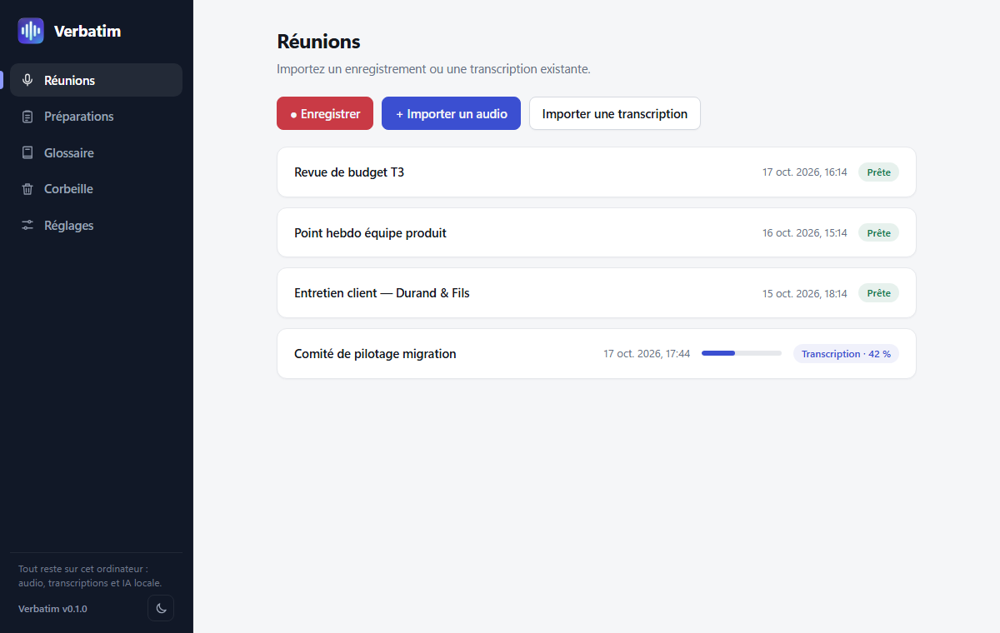
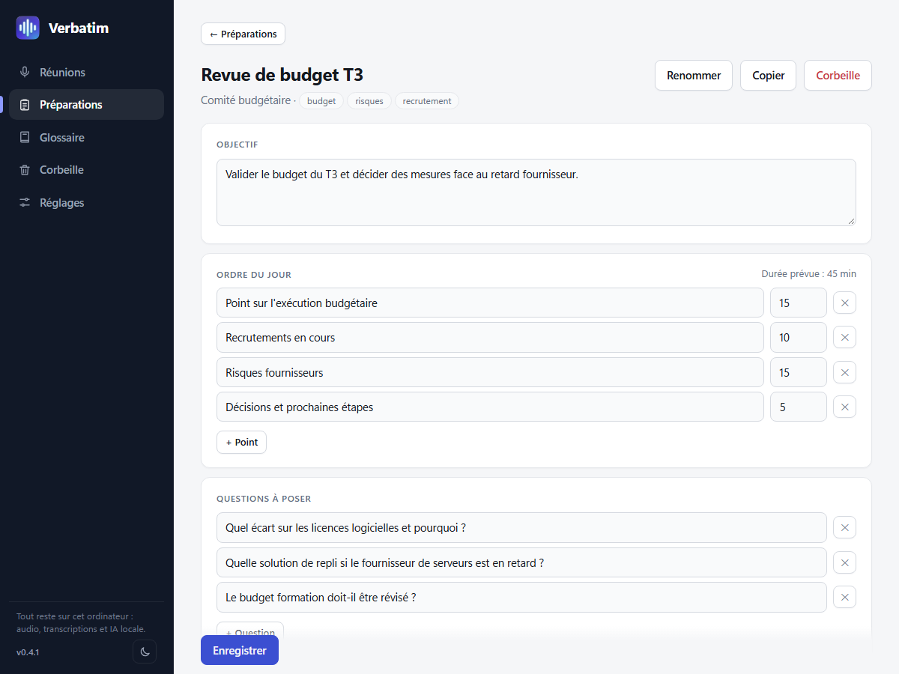
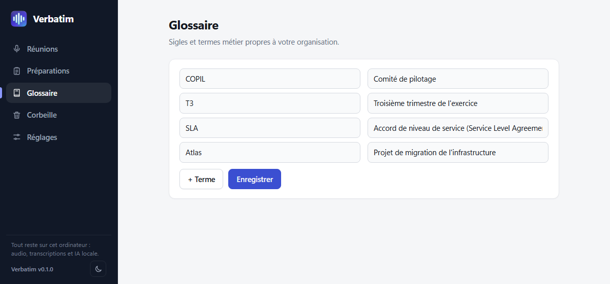
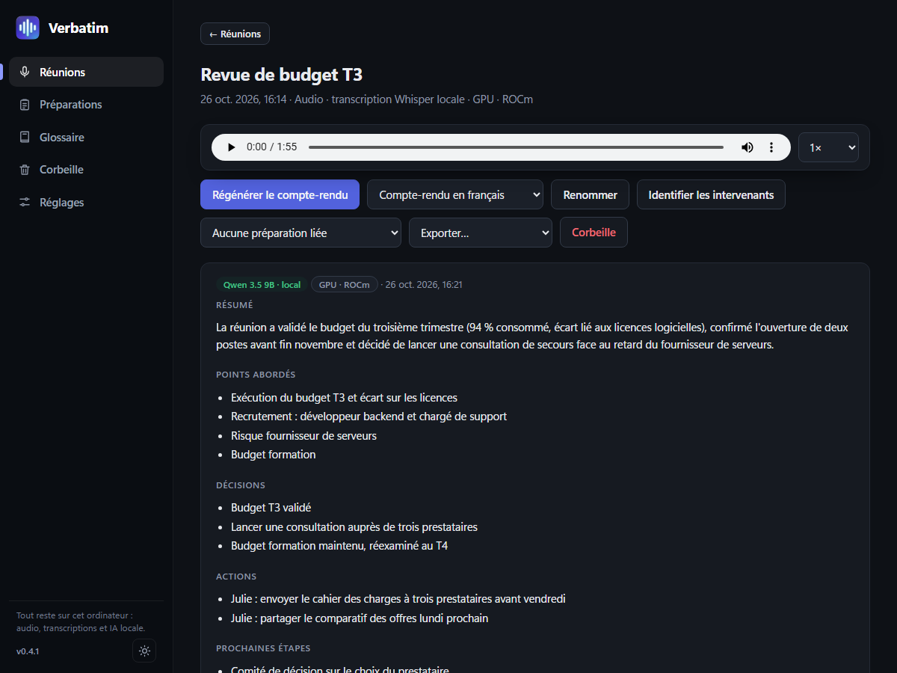
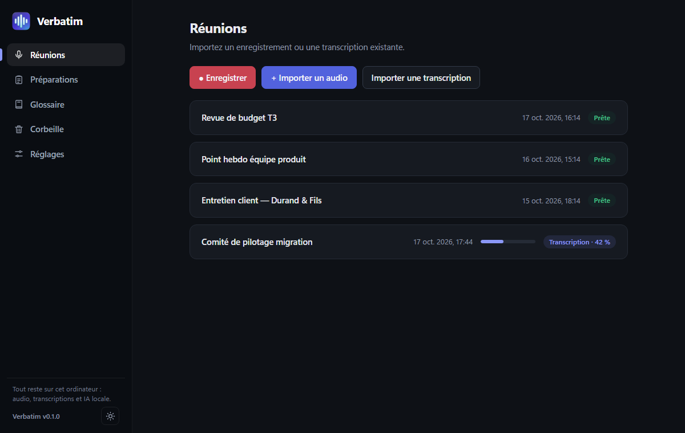
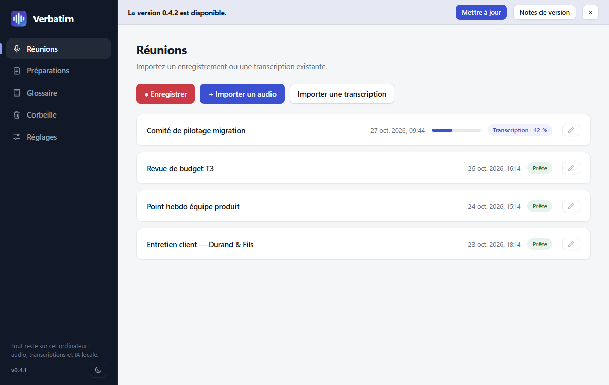
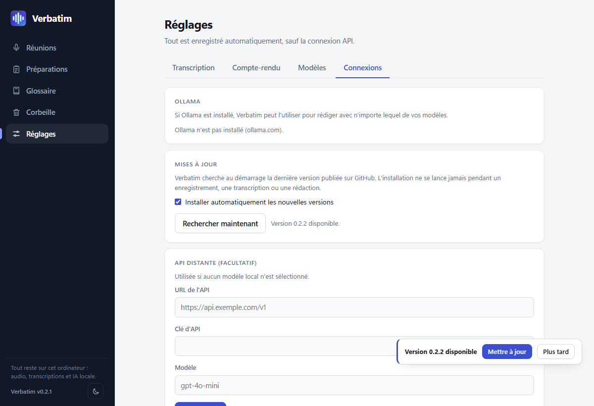

# Verbatim

[Français](PRESENTATION.md) · English

**Transcribe your meetings and get written reports, without anything leaving your computer.**

Verbatim is a Windows desktop application. It records or imports your meetings, transcribes them with Whisper, then writes the report with an AI that runs on your own machine: audio, transcripts and models stay with you. The application sends nothing online, unless you configure a remote API yourself.

[**Download the installer**](https://github.com/Netapick/verbatim/releases/latest) · Windows x64

> The screenshots in this document use fictional meetings and show the French interface; the application is also available in English.

---

## Why Verbatim?

| | |
|---|---|
| **100% local** | Whisper (transcription) and Qwen via llama.cpp (writing) run on your PC. No account, no subscription, no data sent. |
| **From audio to report** | Recording or audio import, timestamped transcription, then summary, topics, decisions, actions and next steps. |
| **Accelerated by your graphics card** | AMD GPU (ROCm, Vulkan) or NVIDIA (CUDA, Vulkan), with automatic fallback to the processor. Whisper has no official Windows binary for AMD: Verbatim ships a ROCm build compiled for Radeon RX 7000 cards. |
| **Built for meetings** | Preparations (agenda, questions), glossary of business acronyms, audio player synchronized with the transcript. |

---

## Record or import

One click on **● Record** captures the **microphone**, the **PC sound** (video calls, videos, via WASAPI loopback) or both, mixed to mono. Levels are shown live, with pause/resume and sensitivity adjustment.

- Audio is written to disk as you go: after a crash or power loss, the recording is rebuilt on the next launch (at most about 2 seconds lost).
- You can also **import audio** (mp3, m4a/aac, ogg, flac, wav…) or **an existing transcript** (txt, srt, vtt, md).
- Transcription starts automatically, showing progress as a percentage and the hardware used (CPU or GPU).

---

## Report and transcript

Each meeting brings together an audio player (0.75× to 2×), the report and the timestamped transcript. Clicking a passage of the transcript starts playback at that moment, and the current passage is highlighted.

- **Summary**, **topics**, **decisions**, **actions** and **next steps**, generated by the local AI.
- Long meetings are split into parts, summarized, then merged. The glossary and the linked preparation are provided to the model.
- **Export**: text, subtitles (.srt, .vtt), data (.json), report (.md) and the original audio.
- Without a writing model or API, Verbatim produces a simplified summary built from real sentences of the transcript, inventing nothing.

---

## Prepare your meetings

For each meeting, generate a plan: **objective**, **timed agenda** and **questions to ask**. Meeting types (budget committee, project kickoff, interview…) are customizable, each with its own instruction to guide the AI.

A preparation can be linked to a meeting: it is then given to the AI when writing the report.

---

## A glossary for your acronyms

Add your acronyms and business terms: they are passed to Whisper as initial vocabulary and to the writing model, to limit mistakes on proper names and acronyms.

---

## Settings: your models, your hardware

**Transcription**: choice of language (French, English, Spanish, German, Italian or automatic detection) and of Whisper model, from the lightest (Tiny, 75 MB) to the most accurate (Large v3, with compressed versions). "Automatic" mode: GPU when available, fallback to the CPU in case of problems.

**Report**: local **Qwen 3.5** AI (4B or 9B) and **Qwen 3.8 27B**, run by llama.cpp, with computation on CPU, Vulkan or ROCm. The model is only loaded into memory while writing. You can also reuse models that are already present (GGUF, Ollama): they are copied into Verbatim's folder, the originals are not modified.

---

## Light and dark theme

A button at the bottom left switches between the two themes; by default, the system theme is used.

---

## Automatic updates

At startup, Verbatim looks for the latest version published on GitHub. If it finds one, it verifies the installer's SHA-256 checksum, installs it silently, then restarts, within a few seconds. Your meetings, settings and models are kept.

The installation **never** starts during a recording, a transcription or report writing: a banner then offers the update, to do whenever you want.

Updates are configured in **Settings › Connections**: you can turn off automatic installation or run a check on demand.

---

## Installation

1. Download `Verbatim_X.Y.Z_x64-setup.exe` from the [releases page](https://github.com/Netapick/verbatim/releases/latest) (lightweight installer, about 3 MB, in French or English).
2. The installer downloads the base engines by itself, without asking anything (≈ 61 MB: Whisper and llama.cpp, with Vulkan). It also detects your graphics card and adds the matching acceleration: ROCm (≈ 430 MB) for a Radeon RX 7000, CUDA (≈ 685 MB) for an NVIDIA card. Without a compatible card, Verbatim uses the processor.
3. Launch Verbatim, then download a transcription model and, if you wish, a writing model from the **Settings**. No model is shipped with the application.

**Automatic updates**: at startup, Verbatim looks for the latest version published on GitHub, verifies its SHA-256 checksum, installs it, then restarts. Never during a recording, a transcription or report writing (a banner then offers the update). Can be turned off in Settings › Connections.

Installation is per user, without administrator rights. Engines and models are stored in an `ia` folder next to the application.

### If your antivirus blocks an engine

The engines (whisper.cpp, llama.cpp) are unsigned third-party programs: some antivirus products, including Windows Defender, delete them or quarantine them by mistake. Typical signs: "Access denied (error 5)" when downloading, or "an existing connection was forcibly closed (error 10054)" while writing a report.

1. Open **Windows Security › Virus & threat protection › Manage settings › Exclusions**, then **Add an exclusion › Folder**, and choose Verbatim's installation folder (the one containing `ia`).
2. In **Protection history**, restore the quarantined files, or simply restart the engine download from the **Settings**.

There is no need to run Verbatim as administrator: it does not change the antivirus scan. If report writing on the graphics card is cut off, Verbatim retries on its own on the processor.

## In short

- Windows x64 · French and English interface (chosen at installation, can be changed in Settings)
- Whisper (whisper.cpp) for transcription, Qwen (llama.cpp) for writing
- No speaker separation for now: a single "Intervenant" (speaker)
- Third-party components under their respective licenses (whisper.cpp, llama.cpp, ROCm): see `THIRD-PARTY-LICENSES.md` in the release

Source code and technical documentation: [README](../README.en.md).
